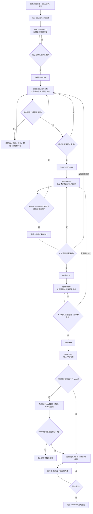

# 规格驱动开发流程

本目录下的 6 个 Skill 用于 OA、采购、审批、台账等业务系统，从原始需求逐步形成可执行代码与交付审计。每个阶段只处理自己的职责，前一阶段未经人工确认，不进入下一阶段。

## 一、目录和过程文件

每个功能使用独立规格目录：

```text
spec/<spec-path>/
├── raw-requirements.md  # 原始需求、会议记录、原型说明
├── clarification.md     # 已确认的轻量业务需求澄清
├── requirements.md      # 已确认的正式业务与技术需求
├── design.md            # 已评审的技术设计
└── tasks.md             # 已评审的开发任务清单
```

调用 Skill 时建议明确提供 `spec/` 下的相对路径，例如：

```text
使用 $spec-clarification platform/audit
使用 $spec-requirements platform/audit
使用 $spec-design platform/audit
使用 $spec-tasks platform/audit
使用 $spec-impl platform/audit
使用 $spec-review platform/audit
```

`$1=platform/audit` 仅是兼容写法。未提供路径时，Skill 只有在能够唯一定位功能目录时才可继续；存在多个候选时必须先询问用户。

## 二、完整流程图



## 三、阶段步骤

### 1. 准备原始需求

将未经加工的客户需求、会议纪要、原型说明和业务背景写入：

```text
spec/<spec-path>/raw-requirements.md
```

原始需求允许简短、零散和存在歧义，不要提前伪装成正式需求。

### 2. 业务需求澄清：`spec-clarification`

输入：

- `raw-requirements.md`
- 会议记录、原型和用户补充材料

执行重点：

1. 明确目标、角色、范围内外和相邻系统职责。
2. 澄清业务规则、核心流程、权限、数据口径和异常边界。
3. 每轮只讨论 1 至 3 个高影响问题。
4. 汇总确认摘要，等待需求方明确确认。
5. 确认后生成 `clarification.md`。

本阶段不设计页面字段、API、数据库、Java 类或实现代码。

### 3. 正式需求细化：`spec-requirements`

输入：

- 已确认的 `clarification.md`
- 页面原型、截图、现有页面和接口材料
- 本系统同类功能

输出必须覆盖适用的业务需求、页面需求、接口需求、权限需求、流程需求、非功能需求和 EARS 验收标准。

写入 `requirements.md` 前必须关闭所有用户可见阻塞项，包括：

- 页面入口、字段、按钮、查询、排序、分页和反馈；
- 接口业务输入、输出和错误语义；
- 功能权限、按钮权限、数据范围和越权结果；
- 状态流转、撤回、驳回、取消和失败路径；
- 多条数据或多字段变化的展示、分组和汇总方式。

仍有上述待确认项时不得生成正式 `requirements.md`。数据库表、类、文件、算法和基础设施等内部实现问题留到设计阶段。

### 4. 技术设计：`spec-design`

输入：

- 已确认且用户可见口径完整的 `requirements.md`
- 项目规范和本系统现有实现

先按复杂度选择设计级别：

| 级别 | 适用范围 | 设计重点 |
| --- | --- | --- |
| 轻量 | 普通 CRUD、表单、列表、详情 | 页面接口、文件清单、数据库变更、校验、权限和测试重点 |
| 标准 | 流程、权限、跨表事务、导入导出 | 状态流转、事务边界、核心服务和异常路径 |
| 深度 | 外部系统、复杂计算、高并发、异步一致性 | 调用链、性能、安全、补偿、一致性和运维风险 |

设计要求：

1. 优先复用本系统已有页面、DTO、Service、Mapper、权限和流程模式。
2. 复用平台能力时，必须写清适用场景、真实接入入口、关键契约、选择规则、事务/AOP/线程边界、失败行为和限制。
3. Java 项目必须使用 Java 风格伪代码及真实类、方法、DTO、Entity、Mapper、Service、异常和注解。
4. 文件清单必须具体到文件，不能使用通配符或“必要时修改”。
5. 设计稿由用户或指定评审人确认后才能进入任务拆分。

### 5. 任务拆分：`spec-tasks`

输入：

- 已确认的 `requirements.md`
- 已评审的 `design.md`

普通 CRUD 使用轻量任务清单，可按一个完整业务能力合并页面、接口、Service、Mapper 和验证。流程、权限、事务或复杂集成使用标准任务清单，并按需补充依赖、边界和联调任务。

每个任务必须：

- 对应数字需求 ID；
- 有明确交付物和可观察完成条件；
- 承接设计文件、DDL、服务逻辑和验证要求；
- 不在任务阶段新增技术设计或改变需求口径。

人工确认 `tasks.md` 后才能开始实现。

### 6. 代码实现：`spec-impl`

输入：

- 已确认的 `requirements.md`
- 已评审的 `design.md`
- 已评审的 `tasks.md`

执行顺序：

1. 确认目标任务、依赖和工作区现有改动。
2. 检查目标模块的运行时 Mock 数据、Mock 路由、接口桩、Mock 开关、硬编码数组和假数据回退。
3. 存在 Mock 时先清理数据、注册、引用和配置；测试 fixture 默认保留。
4. 确认没有 Mock 残留或悬空引用后，再按设计编码。
5. 优先复用现有业务实现，不擅自改变状态、权限、数据范围和流程。
6. 运行相关单元测试、检查、构建和必要的集成验证。
7. 只有实现完成且验证通过后，才勾选 `tasks.md` 对应任务。

### 7. AI 辅助代码评审与交付治理：`spec-review`

输入：
- 当前变更（Git Diff）与相关业务规格文件（`spec.md` 或 `requirements.md`）
- 项目根目录 `AGENTS.md` 与企业级双级 Checklist (B-01~B-06 阻断项)

执行重点：
1. 扫描代码变更是否违背架构底线与契约边界（Servlet耦合、精度截断、敏感日志、SQL注入、假测试）。
2. 输出结构化《代码健康与安全审计卡》（`evidence/ai-review-report.md`）。
3. 辅助架构师进行独立终审与签署（`APPROVE` / `REJECT`），落实不可外包的人工交付责任。

## 四、回退原则

发现问题时回到拥有该决策权的阶段：

| 问题 | 回退阶段 |
| --- | --- |
| 业务目标、角色、范围或规则不清 | `spec-clarification` |
| 页面、接口、权限、流程或验收口径不清 | `spec-requirements` |
| 表结构、类、文件、事务、接入契约或实现方案不清 | `spec-design` |
| 任务遗漏、顺序、依赖或粒度不合理 | `spec-tasks` |
| 代码错误、测试失败或 Mock 残留 | `spec-impl` |

后续阶段不得自行替前一阶段补做业务决策。
