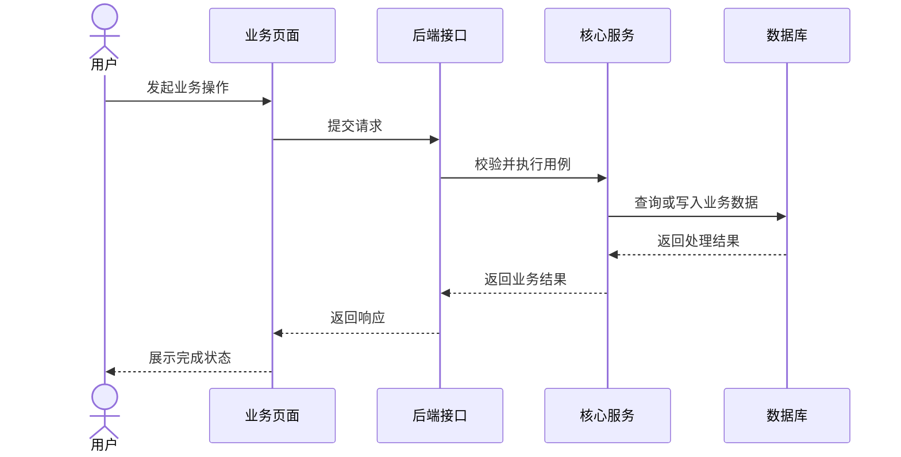

# 技术设计

> 面向 OA、采购、审批、台账等业务系统。文档重点回答：代码改在哪里、数据如何落库、核心逻辑如何实现、复杂流程如何串联。
> 与当前需求无关的章节直接省略，不保留空标题或占位内容。

- **设计级别**：轻量 / 标准 / 深度
- **判定依据**：{{CRUD_FORM_LIST / FLOW_PERMISSION_TRANSACTION / EXTERNAL_COMPLEX_HIGH_CONCURRENCY}}

## 一、方案概述

### 1.1 业务目标

{{用 3 至 5 条说明本次解决的业务问题、目标用户和完成后的可观察结果。}}

### 1.2 实现范围

- **本次实现**：{{功能范围}}
- **不在本次实现**：{{明确排除项}}
- **复用能力**：{{复用的现有页面、组件、服务、权限、流程或基础设施}}
- **关键约束**：{{仅写会影响实现的项目规范、兼容性或业务约束}}

### 1.3 总体实现说明

{{用一段话说明前端、后端、数据库如何协作。普通 CRUD 不画架构图；只有涉及 3 个以上系统或存在异步链路时才补充简图。}}

### 1.4 复用能力接入契约（复用平台或公共能力时必填）

| 复用能力 | 适用场景 | 接入入口 | 关键契约 | 选择规则 | 事务/调用边界 | 失败行为与限制 |
| --- | --- | --- | --- | --- | --- | --- |
| `{{REAL_CAPABILITY}}` | {{WHEN_TO_USE}} | `{{REAL_CLASS_OR_METHOD_OR_ANNOTATION}}` | {{PARAMETERS_AND_RESULT}} | {{ANNOTATION_VS_API_OR_OTHER_CHOICE}} | {{TRANSACTION_AOP_THREAD_BOUNDARY}} | {{FAILURE_AND_LIMITATIONS}} |

{{使用项目真实语言给出至少一个最小接入示例。Java 项目必须展示真实类、方法和影响行为的注解。}}

## 二、源代码文件清单

> 必填。列出本次全部新增和修改的源代码文件。路径必须具体到文件，不只写目录；一个文件只承担一个主要职责。

### 2.1 前端文件

| 类型 | 文件路径 | 主要职责 | 关联需求 |
| --- | --- | --- | --- |
| 新增/修改 | `src/views/.../index.vue` | {{页面入口与主要交互}} | {{需求 ID}} |
| 新增/修改 | `src/views/.../comp/Example.vue` | {{页面私有组件职责}} | {{需求 ID}} |
| 新增/修改 | `src/api/.../example.js` | {{接口调用或 mock 切换边界}} | {{需求 ID}} |
| 新增/修改 | `src/router/modules/...js` | {{静态路由职责}} | {{需求 ID}} |

### 2.2 后端文件（涉及后端时填写）

| 类型 | 文件路径 | 主要职责 | 关联需求 |
| --- | --- | --- | --- |
| 新增/修改 | `.../controller/ExampleController.java` | {{接口入口}} | {{需求 ID}} |
| 新增/修改 | `.../service/ExampleService.java` | {{业务能力契约}} | {{需求 ID}} |
| 新增/修改 | `.../service/impl/ExampleServiceImpl.java` | {{核心业务编排}} | {{需求 ID}} |
| 新增/修改 | `.../mapper/ExampleMapper.java` | {{数据访问}} | {{需求 ID}} |
| 新增/修改 | `.../domain/Example.java` | {{领域或持久化对象}} | {{需求 ID}} |

### 2.3 配置、脚本与测试文件（存在时填写）

| 类型 | 文件路径 | 主要职责 | 关联需求 |
| --- | --- | --- | --- |
| 新增/修改 | `...` | {{配置、DDL、迁移、测试或其他职责}} | {{需求 ID}} |

### 2.4 文件依赖关系

{{只说明不明显的调用方向，例如：页面 → API → Controller → Service → Mapper。普通分层调用无需展开成长篇架构说明。}}

> 优先复用现有页面、DTO、Service、Mapper、权限和流程模式；只有现有职责确实无法承接时才新增文件或公共能力。

## 三、数据库 DDL 设计（涉及后端数据变更时填写）

### 3.1 表与关系说明

| 表名 | 用途 | 主键 | 关键关系 | 数据生命周期 |
| --- | --- | --- | --- | --- |
| `example_table` | {{业务用途}} | `id` | {{外键或逻辑关联}} | {{新增、更新、软删除、归档规则}} |

### 3.2 DDL

```sql
-- 提供可执行的目标数据库 DDL，包括字段注释、主键、必要索引和约束。
CREATE TABLE example_table (
    id BIGINT NOT NULL,
    -- 业务字段
    PRIMARY KEY (id)
);
```

### 3.3 字段与业务规则

| 字段 | 类型 | 是否为空 | 默认值 | 业务含义与约束 |
| --- | --- | --- | --- | --- |
| `id` | `BIGINT` | 否 | 无 | {{主键生成规则}} |

### 3.4 索引与数据变更

- **索引依据**：{{对应的查询、排序或唯一性场景}}
- **历史数据处理**：{{初始化、迁移、回填或兼容方案；无则写“无”}}
- **事务边界**：{{哪些写操作必须原子完成}}

## 四、核心服务实现伪代码（存在核心业务逻辑时填写）

### 4.1 {{服务或用例名称}}

- **入口**：`{{Service.method(...)}}`
- **输入**：{{关键输入及校验规则}}
- **输出**：{{返回结果}}
- **前置条件**：{{权限、状态、数据存在性}}
- **异常结果**：{{明确的业务异常}}

```java
@Transactional(rollbackFor = Exception.class)
public {{ResultType}} {{realMethodName}}({{RealRequestDto}} request) {
    validateRequest(request);
    checkPermissionAndDataScope(request);
    {{RealEntity}} entity = {{realMapper}}.selectById(request.getId());
    if (entity == null) {
        throw new {{RealBusinessException}}("{{明确业务错误}}");
    }

    applyBusinessRules(entity, request);
    {{realMapper}}.updateById(entity);
    return buildResult(entity);
}
```

> Java 项目使用 `java` 代码块，名称必须来自现有代码或本设计文件清单中明确新增的类型。按实际设计展示 `@Transactional`、审计、AOP、权限等影响行为的注解；不要使用 `function`、`raise` 或 `begin transaction`。

### 4.2 关键规则说明

1. {{规则优先级、计算口径或状态限制}}
2. {{重复提交、幂等、并发冲突的处理}}
3. {{数据权限、流程权限或审计规则}}

> 普通单表 CRUD 不需要伪代码，只需在文件清单和接口说明中写清校验与保存规则。

## 五、复杂流程时序（后端复杂业务或跨系统流程时填写）

### 5.1 {{流程名称}}



### 5.2 分支与异常

| 场景 | 处理方式 | 最终状态 |
| --- | --- | --- |
| {{权限不足}} | {{拒绝并返回明确提示}} | {{数据不变}} |
| {{业务状态冲突}} | {{终止或引导处理}} | {{保持原状态}} |
| {{外部系统失败}} | {{重试、补偿或人工处理}} | {{说明一致性状态}} |

> 仅有一次请求和一次保存的简单流程不画时序图。状态较复杂时，可额外增加状态图，但不要重复描述图中已有信息。

## 六、接口与页面协作（按需填写）

### 6.1 接口清单

| 方法 | 路径 | 用途 | 关键入参 | 关键返回 | 权限 |
| --- | --- | --- | --- | --- | --- |
| `GET/POST` | `/api/...` | {{业务用途}} | {{关键字段}} | {{结果结构}} | {{功能与数据权限}} |

只为存在业务规则或跨边界协作的接口补充请求/响应示例。普通字段可引用 DTO 或数据表说明，不重复铺陈完整结构。

### 6.2 页面行为

- **页面入口**：{{路由和进入条件}}
- **查询与展示**：{{查询条件、表格列、分页或统计口径}}
- **新增/编辑/查看**：{{弹窗、抽屉、表单和详情行为}}
- **操作权限**：{{按钮、字段和数据范围控制}}
- **状态反馈**：{{加载、空状态、成功、失败和刷新行为}}

## 七、验证重点与风险

### 7.1 验证重点

| 验证项 | 验证结果 | 关联需求 |
| --- | --- | --- |
| {{核心正常流程}} | {{可观察的成功状态}} | {{需求 ID}} |
| {{权限或数据边界}} | {{越权不可见或不可操作}} | {{需求 ID}} |
| {{关键异常流程}} | {{错误提示与数据一致性}} | {{需求 ID}} |

### 7.2 风险与待确认项

- {{只记录会影响开发、数据安全、兼容性或上线的真实风险；无则写“无”。}}
