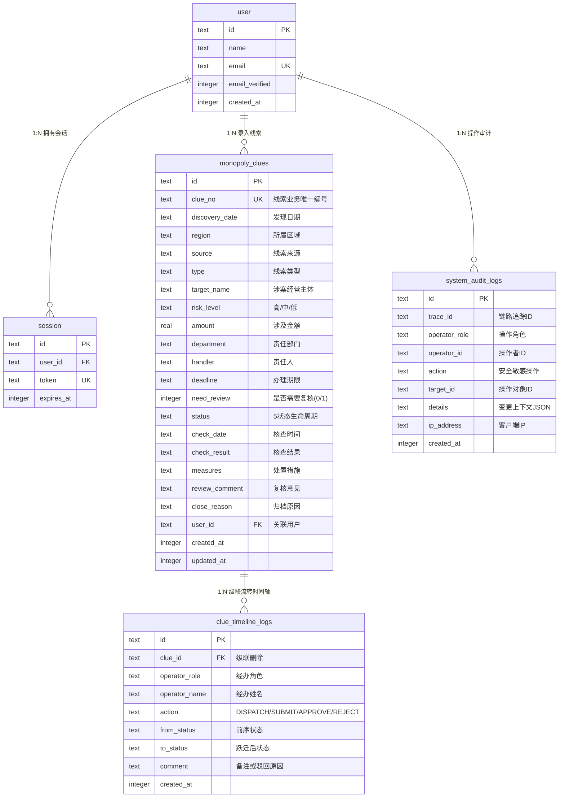
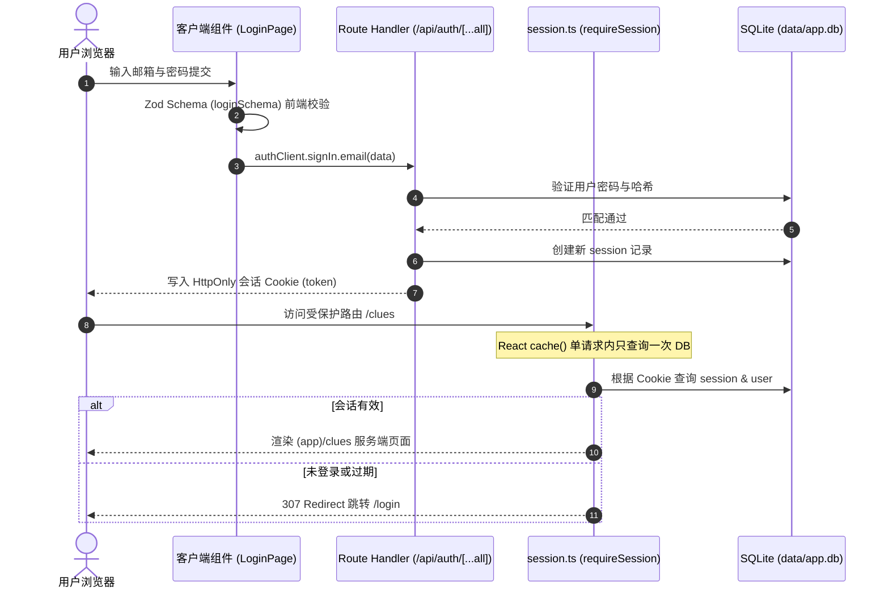
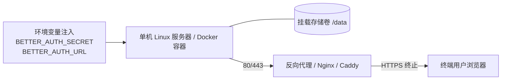
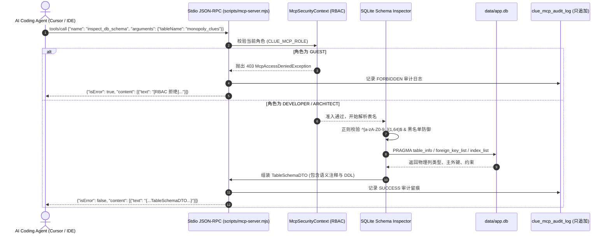

# clue-lens 架构地图 (ARCHITECTURE.md)

> **定位:** 本文件是本工程当前代码的导航地图，记录工程的真实架构模式、模块目录职责、数据表关系与调用链路。  
> **设计哲学:** **坚持 Next.js 原生心智，坚决拒绝 J2EE 机械套壳。** 不搞冗余无意义的 Interface/Impl/VO 胶水层，采用现代全栈高内聚、轻量、类型安全的三层分层模型（RSC/Actions 表现层 $\rightarrow$ 纯函数领域规则层 $\rightarrow$ DAL 数据访问层 $\rightarrow$ Drizzle 实体层）。

---

## 1. 现代化 Next.js 原生分层架构 (Non-J2EE Pattern)

本工程严格遵循 Vercel 官方《Data Security & Server Actions in Next.js》推荐的工业级最佳实践，既杜绝代码全堆在单个文件的“大泥球”，又避免 J2EE 的“过度抽象”：

```mermaid
graph TD
    subgraph 表现与入口层_Presentation_Layer
        RSC[服务端只读页面 RSC<br/>src/app/(app)/**/page.tsx]
        CLIENT[客户端交互组件<br/>src/components/**]
        ACTION[变更动作 Server Actions<br/>src/app/actions/**/*.ts]
    end

    subgraph 领域与规则层_Domain_Layer
        ANOMALY[异常检测纯函数<br/>src/lib/anomaly-detector.ts]
        ADVISORY[双模处置建议引擎<br/>src/lib/advisory-engine.ts]
        EXCEL[Excel流式解析与对齐<br/>src/lib/excel-parser.ts]
        EXPORTER[报告生成服务<br/>src/lib/report-exporter.ts]
    end

    subgraph 数据访问层_DAL_Data_Access_Layer
        DAL[数据访问函数 DAL<br/>src/dal/*.ts 或 src/db/queries/*.ts]
        SESSION[会话与鉴权门禁<br/>src/lib/session.ts]
        VALIDATION[Zod 参数防卫<br/>src/lib/validations/*.ts]
    end

    subgraph 持久化与驱动层_Persistence_Layer
        DRIZZLE[Drizzle ORM<br/>src/db/index.ts & schema.ts]
        SQLITE[(SQLite 单文件数据库<br/>data/app.db - WAL模式)]
    end

    CLIENT -->|表单提交 / RPC调用| ACTION
    CLIENT -->|页面跳转| RSC
    RSC -->|零API开销/只读聚合| DAL
    RSC -->|React cache 去重| SESSION
    ACTION -->|1. 身份守卫 requireSession| SESSION
    ACTION -->|2. 入参防卫 safeParse| VALIDATION
    ACTION -->|3. 核心业务计算| ANOMALY
    ACTION -->|3. 核心业务计算| ADVISORY
    ACTION -->|4. 数据写入与状态跃迁| DAL
    DAL -->|类型安全查询构建| DRIZZLE
    DRIZZLE -->|原生连接| SQLITE
```

### 1.1 分层职责与设计规约

| 分层 | 对应目录 | 核心职责 | 绝不做什么（反模式禁令） |
|---|---|---|---|
| **1. 表现与入口层** | `src/app/**/page.tsx`<br>`src/app/actions/**`<br>`src/components/**` | - **RSC 页面**：服务端直接调 DAL 查数，直接流式返回 HTML，享受零网络开销。<br>- **Server Actions**：作为写操作的 Controller，强制执行“四部曲”：`requireSession` 鉴权 $\rightarrow$ Zod 防御 $\rightarrow$ 调用 DAL/领域逻辑 $\rightarrow$ `revalidatePath`。<br>- **Client Components**：专注前端用户交互与表单输入。 | ❌ 严禁在组件中手写拼接 SQL<br>❌ 严禁写冗余的 J2EE 风格纯透传 Controller<br>❌ 严禁客户端直接信任未校验的入参 |
| **2. 领域与规则层** | `src/lib/*-detector.ts`<br>`src/lib/*-engine.ts`<br>`src/lib/report-*.ts` | 封装**无状态纯函数（Pure Functions）**，如 5 维异常计算规则、专家处置规则树、Markdown 模板渲染。 | ❌ 不与特定框架生命周期深度耦合<br>❌ 不直接操作 HTTP 请求上下文，保证 100% 单元测试免 Mock 运行 |
| **3. 数据访问层 (DAL)** | `src/dal/**/*.ts`<br>或 `src/db/queries/**/*.ts` | 集中封装 Drizzle ORM 的查询语句（如 `getClueById`、`listCluesWithFilter`、`upsertCluesBatch`）。配合 React `cache()` 实现请求期去重。 | ❌ 不在 DAL 内部直接读取客户端请求头或 Cookie<br>❌ 不把复杂的界面交互逻辑混入数据层 |
| **4. 持久化与实体层** | `src/db/schema.ts`<br>`src/db/index.ts` | 唯一权威物理 DDL 声明与 TypeScript 类型推导源。定义主键、唯一约束、外键级联与索引。 | ❌ 严禁维护两套分离的 Entity 类与 DTO 类（Drizzle `$inferSelect` 原生推导） |

---

## 2. 数据库设计与持久化规范 (SQLite)

### 2.1 专卖监管线索核心实体关系图



### 2.2 存储与运行特征

- **零外部服务依赖:** 默认写入 `data/app.db`，由 Node.js 进程直连，无需安装 PostgreSQL/MySQL 服务。
- **WAL 并发模式:** 开启 `PRAGMA journal_mode = WAL;`，读写互不阻塞，大幅提升 SQLite 在 Web 场景下的并发读取吞吐。
- **外键级联保障:** 开启 `PRAGMA foreign_keys = ON;`，级联删除（`onDelete: "cascade"`）完全由数据库内核兜底，防止孤儿数据。
- **热更新句柄防泄漏:** 通过 `globalThis.sqlite` 缓存连接实例，解决 Next.js 极速热编译（HMR）重复初始化连接导致的句柄堆积。

---

## 3. 认证授权与会话安全流转机制

Better Auth 与 Next.js 15 App Router 的全生命周期交互链路如下：



---

## 4. 前端组件与样式架构

- **Tailwind CSS v4 原生引擎:** 使用 `@tailwindcss/postcss` 编译器，样式入口位于 `src/app/globals.css`。全面摒弃旧版 JavaScript 配置文件，采用 `@theme inline` 映射 CSS 变量，原生支持现代 OKLCH 色域。
- **设计令牌与暗黑模式:**
  - 根样式采用 `:root` 与 `.dark` 类名切换。
  - 通过 `@custom-variant dark (&:is(.dark *));` 实现无缝暗色模式切换。
- **shadcn/ui New York 规范:**
  - 组件均标注 `data-slot` 属性（如 `data-slot="button"`），语义清晰且易于全局覆盖样式。
  - 采用 `@radix-ui/react-*` 无样式可访问性基建，配合 `class-variance-authority` (cva) 处理多种尺寸与变体。

---

## 5. 运维与生产部署拓扑



- **容器化部署要点:** 使用 Debian 系基础镜像（如 `node:22-slim`），保证 `better-sqlite3` 原生 C++ 编译插件在运行时具备 glibc 支持。
- **数据持久化:** Docker 容器必须通过 `-v $(pwd)/data:/app/data` 挂载主机持久化目录，防止容器销毁后 SQLite 数据库丢失。
- **备份建议:** 支持使用 SQLite 原生 `.backup` 命令，或在线复制 `app.db`、`app.db-wal`、`app.db-shm` 三个文件实施热备份。

---

## 6. MCP 智能体服务与 SQLite Schema 探查机制

为方便 Cursor / Claude Desktop / Antigravity 等 AI 辅助编码智能体精准获取本工程 SQLite 结构，工程内置了标准的 MCP 服务器：



- **安全边界保障:**
  - 严禁查询 `SELECT *` 真实数据，只允许调阅元数据。
  - 表名入参正则强制防御 SQL 注入。
  - 黑名单防御涉密表（如 `ops_user_credential`）。
  - 所有诊断输出强制流向 `stderr`，保障 `stdout` 纯净供 JSON-RPC 通信。
