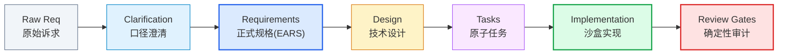
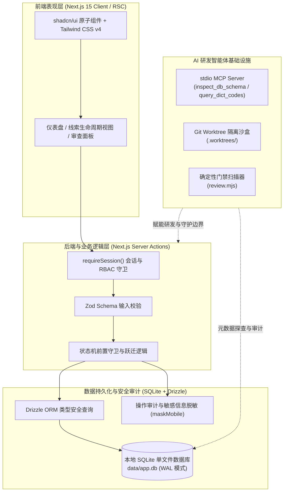

<div align="center">

# 🔍 clue-lens (线索透视)

### 企业级全栈 SDD (规格驱动开发) × AI Coding 最佳实践沙盒与治理范式
**A Production-Grade Spec-Driven Development & AI Agent Governance Sandbox for Full-Stack Engineering**

[English](README_en.md) | [简体中文](README.md)

<br/>

[](LICENSE)
[](https://nextjs.org/)
[](https://react.dev/)
[](https://www.typescriptlang.org/)
[](https://orm.drizzle.team/)
[](https://www.sqlite.org/)
[](https://tailwindcss.com/)
[](#-3-原生-mcp-研发治理基建)
[](#-1-五阶段-sdd-闭环研发流水线)
[](#-4-git-worktree-物理隔离沙盒)

</div>

---

## 💡 为什么需要 SDD？（Why Spec-Driven Development?）

> *“在 AI Coding 时代，写代码的成本无限趋近于零，但修复错误代码与理解混乱架构的成本正指数级飙升。”*

当今市面上 99% 的 AI Coding 教程和模板仍停留在玩具级的“聊天式写代码（Vibe Coding）”阶段。在面对真实复杂企业级业务时，这种模式必然遭遇四大死局：

1. **上下文黑洞与幻觉蔓延**：随着对话轮次增加，超长 Context 导致大模型丢失前期约束，甚至凭空捏造不存在的 API 或数据库字段。
2. **缺乏单一权威源（SSOT）**：需求散落在几十轮即时对话中，没有形式化规格定义。AI 写出的测试在验证错误的逻辑，陷入“连测试带实现一起错”的恶性循环。
3. **架构隐性破坏与屎山生成**：AI 缺乏全局架构视野，随意跨层调用、绕过鉴权、缺少输入防卫与状态机守卫，项目迅速腐化且无法维护。
4. **多任务与多智能体冲突**：多个 Agent 或人机并发操作同一工作区时，发生文件覆盖、Git 冲突与 SQLite 数据库锁死。

### 🌟 破局之道：规格驱动开发（SDD）

**clue-lens** 是一个完整的全栈工程样本，完整打样了面向 AI Coding 的 **规格驱动开发（SDD）与 Agent 治理体系**：



- **规格先行（Spec-First）**：需求未经澄清不写正式规格；正式规格未经确认不写架构设计；设计未经评审不拆解开发任务；任务未达标坚决禁止合并代码。
- **全链路有法可依**：将业务规则形式化为 EARS 契约，让人类与 AI 始终对齐在统一的单一权威源（SSOT）之上。

---

## 🔥 5 大核心工程护城河

### 🛡️ 1. 五阶段 SDD 闭环研发流水线
在 [`spec/`](file:///Users/yubin/workspaces/2026product/clue-lens/spec) 目录下为业务模块沉淀完整的 5 阶段演进资产，杜绝“空口套代码”：
- **阶段 1：需求捕获 (`raw-requirements.md`)**：保留业务痛点与粗粒度愿景。
- **阶段 2：需求澄清 (`clarification.md`)**：通过多轮反问深挖异常流、角色准入与临界值，形成不可逆的业务决策。
- **阶段 3：正式规格 (`requirements.md`)**：SSOT 核心契约，采用 EARS 验收标准、SLA 承诺与严密的状态机跃迁图。
- **阶段 4：技术设计 (`design.md`)**：依据系统规范输出数据库表、Server Actions 契约与前后端调用拓扑。
- **阶段 5：任务分解 (`tasks.md`)**：拆解为具备单向依赖拓扑与自动化验证命令的原子开发任务。

配套提供 6 个开箱即用的 SDD 领域技能：`spec-clarification`, `spec-requirements`, `spec-design`, `spec-tasks`, `spec-impl`, `spec-review`。

### 📋 2. 分层 AI Agent 治理家规体系
AI Coding 最忌讳向上下文灌入数万行冗余规则。本项目推行**渐进式披露与严格分层治理**：
- **统一总纲 [AGENTS.md](file:///Users/yubin/workspaces/2026product/clue-lens/AGENTS.md)**：声明全局架构底线、安全红线与规则导航。
- **按需加载 [rules/](file:///Users/yubin/workspaces/2026product/clue-lens/rules)**：拆分为 8 个高内聚独立规范（架构、数据库、Drizzle ORM、Server Actions、代码风格、测试、安全、Worktree），仅在涉及相应文件时才调入 Context。
- **不可突破的四大架构红线**：
  1. *会话与数据隔离*：严禁信任客户端传入的身份，强制显式绑定会话。
  2. *Zod 边界防御*：所有外部入参必须先经 `zod` 的 `safeParse` 过滤。
  3. *零裸写 SQL*：100% 采用 Drizzle 类型安全查询与参数化插值。
  4. *原生模块守卫*：确保 `better-sqlite3` 配置与句柄复用无内存泄漏。

### 🔌 3. 原生 MCP 研发治理基建
通过 [Model Context Protocol (MCP)](file:///Users/yubin/workspaces/2026product/clue-lens/.mcp.json) 赋能 AI Coding 工具（Claude Code / Cursor / Windsurf / Antigravity）：
- **只读元数据探查 (`inspect_db_schema`)**：允许 AI 准确探查白名单表的字段、索引与 DDL，彻底终结“AI 凭空猜错字段名”引发的运行时崩溃。
- **业务枚举字典查询 (`query_dict_codes`)**：标准化查询状态码、角色与异常字典。
- **细粒度 RBAC 与敏感拦截**：内置角色隔离；涉密黑名单（如用户凭证表）触发访问坚决阻断；所有探查记录由审计日志全程留痕。

### 🌳 4. Git Worktree 物理隔离沙盒
告别多 Agent 协作或人机并发时的文件覆盖与数据库锁死（`database is locked`）：
- 内置开箱即用的工作树管理脚本：`node scripts/agent/worktree.mjs new <slug>`
- **物理独立**：在 `.worktrees/clue-lens-<slug>` 自动建立独立工作副本与独立 Git 分支。
- **沙盒克隆**：自动克隆私有专属的 SQLite 数据库（`data/app.db`）副本，开发期间互不干扰。
- **依赖秒级共享**：自动软链主工程的 `node_modules`，无需重复 `npm install`。
- **严密合并门禁**：改动必须通过全套自动化审查，以 `--ff-only` 快进合并回 `main` 分支。

### 🎯 5. 确定性机器前置审查门禁
绝不依赖“让大模型自己检查自己代码”的虚无主义自评。
- 单一验证命令：`npm run review`（或 `node scripts/review.mjs`）。
- 串联 TypeScript 静态检查、架构命名一致性扫描（`check-consistency`）、Server Actions 鉴权红线静态 AST 扫描（`check-security`）、高危敏感密钥扫描（`check-secrets`）。
- 生成确定性机器审查报告归档至 `evidence/`，门禁未全绿一律阻断合并。

---

## 🏗️ 架构全景与调用拓扑



---

## 🛠️ 技术栈与依赖选型

100% 现代全栈 TypeScript/Node.js 技术栈，前后端一体，运行**零额外中间件**，开箱即跑：

| 层次 | 技术选型 | 核心考量 |
|---|---|---|
| **框架底座** | Next.js 15 (App Router) + React 19 | 现代化 React Server Components (RSC) 与极速 Turbopack 热重载 |
| **持久化层** | SQLite (better-sqlite3) | 本地单文件数据库，开启 WAL 并发模式与外键级联，无外置数据库负担 |
| **ORM 映射** | Drizzle ORM | 极致类型安全，零运行时开销，自动推导 TS 类型 |
| **认证与鉴权** | Better Auth | 现代全栈安全鉴权方案，支持会话守卫与 RBAC 细粒度控制 |
| **设计系统** | Tailwind CSS v4 + shadcn/ui | 现代原子化样式体系，基于 Radix UI 原语，坚决杜绝原生粗糙 HTML |
| **数据校验** | Zod 4 | 端到端类型推导与运行时入参安全防御 |
| **研发协议** | Model Context Protocol (MCP) | 标准化智能体通信协议，提供安全的数据库元数据探查 |

---

## 🚀 快速开始

### 运行环境
- **Node.js**: `>= 20.12`
- **操作系统**: macOS / Linux / Windows (全平台命令一致)

### 安装与启动
```bash
# 1. 克隆代码仓库
git clone https://github.com/your-username/clue-lens.git
cd clue-lens

# 2. 安装工程依赖
npm install

# 3. 一键初始化环境（自动生成安全密钥 .env、初始化 SQLite 数据库并绑定 Git 门禁）
npm run setup

# 4. 启动开发服务器
npm run dev
```

浏览器访问 `http://localhost:3000`，注册账号即可体验内置的业务闭环（线索录入、状态机流转、审查与审计留痕）。

---

## 💻 常用工程命令

| 脚本命令 | 适用场景与说明 |
|---|---|
| `npm run dev` | 启动开发服务器（Turbopack 极速热编译） |
| `npm run build` | 构建 Next.js 生产版本 |
| `npm run typecheck` | TypeScript 静态类型无死角严格检查 |
| `npm run review` | 触发通用确定性机器前置审查门禁（合并前必跑） |
| `npm run check:consistency` | 校验工程目录、数据库表名与规范一致性 |
| `npm run check:security` | 静态扫描 Server Actions 鉴权红线与角色守卫 |
| `npm run db:studio` | 打开 Drizzle Studio 视觉化浏览本地 SQLite 数据 |
| `npm run db:push` | 将 `src/db/schema.ts` 变更直接应用到本地 SQLite |
| `npm run db:generate` | 生成版本化数据库迁移脚本（生产发布推荐） |
| `npm run mcp` | 启动本地 stdio 模式 Model Context Protocol 研发服务 |
| `npm run test:mcp` | 自动化验证 MCP 协议契约与 Schema 探查能力 |

---

## 📂 目录架构与 SDD 资产全景

```text
clue-lens/
├── AGENTS.md                  # AI 智能体治理体系入口、架构红线与渐进式规则索引
├── ARCHITECTURE.md            # 系统实现事实导航地图（分层依赖、ER图、时序图）
├── LICENSE                    # MIT 开源许可证
├── rules/                     # 架构规范与红线约束（可执行规约）
│   ├── 01-project-architecture.md
│   ├── 02-database-design.md
│   ├── 03-drizzle-convention.md
│   ├── 04-server-actions-convention.md
│   ├── 05-coding-style.md
│   ├── 06-test-and-quality-convention.md
│   ├── 07-security-and-auth.md
│   └── 08-worktree-workflow.md
├── spec/                      # 规格中心单一权威源 (SSOT)
│   ├── README.md              # SDD 五阶段流转模型说明
│   └── clue-lens/             # 核心业务模块资产（raw -> clarification -> requirements -> design -> tasks）
├── .agents/                   # 智能体技能中心与流水线清单 (Skills / Manifest)
│   ├── agent-manifest.yml     # 角色边界与输入输出契约治理清单
│   └── skills/                # 6 个标准 SDD 技能（clarification, requirements, design, tasks, impl, review）
├── scripts/                   # 自动化运维、质量门禁与智能体工作流脚本
│   ├── review.mjs             # 门禁审查总入口（npm run review，支持 --staged）
│   ├── review-checks.list     # 门禁审查可插拔配置清单
│   ├── gates/                 # 质量门禁检查脚本 (check-consistency, check-security, check-secrets 等)
│   ├── agent/                 # 多智能体调度与隔离沙盒 (worktree.mjs / agent-run.mjs)
│   └── mcp/                   # MCP 协议服务与探查客户端 (server.mjs)
├── evidence/                  # 确定性机器审查报告输出归档
├── src/                       # 业务源码目录
│   ├── app/                   # App Router 路由组与 Server Actions
│   ├── components/            # shadcn/ui 原子组件与业务复合组件
│   ├── db/                    # Drizzle ORM Schema 与 SQLite 连接
│   └── lib/                   # Better Auth 会话守卫、敏感信息脱敏与 Zod 契约
└── data/                      # SQLite 本地数据库物理存储 (app.db，自动忽略)
```

---

## ❓ 常见问题 (FAQ)

### Q: SDD（规格驱动开发）与 TDD（测试驱动开发）有什么区别？
> **A:** TDD 保证的是“代码按照测试的预期正确运行”，但**无法保证测试用例本身符合业务诉求**。在 AI Coding 时代，让大模型直接写测试，极易发生“AI 连测试带代码一起写错”的自我欺骗。  
> SDD 保证的是“从源头上做正确的事”。通过澄清文档与 EARS 验收标准形成不可逆的业务契约，再由测试去锚定规格，彻底消除了源头失真。

### Q: 为什么企业级 AI Coding 必须使用 Git Worktree 隔离？
> **A:** 传统的单一工作区在多人或多 Agent 并发开发时，会频繁发生文件被悄然覆盖、Git 索引锁死、本地 SQLite 报 `database is locked` 等严重问题。通过 `worktree.mjs`，每个任务拥有独立的沙盒目录、独立 Git 分支与独立的 SQLite 数据文件，实现真正的物理隔离。

### Q: 如何将本模板的 SDD 体系复用到我自己的业务项目中？
> **A:** 本工程的设计理念是完全解耦的：
> 1. 将 `rules/` 与 `AGENTS.md` 复制到你的工程中，根据技术栈微调红线规则；
> 2. 将 `spec/` 规范与 `.agents/skills` 接入你的 AI 编程助手（Claude Code / Cursor / Windsurf 等）；
> 3. 将 `scripts/agent/worktree.mjs` 与 `scripts/review.mjs` 引入你的开发门禁中。

---

## 🤝 贡献指南与开源协议

欢迎提交 Issue、发起讨论或提交 Pull Request！
本项目基于 [MIT License](LICENSE) 开源。
