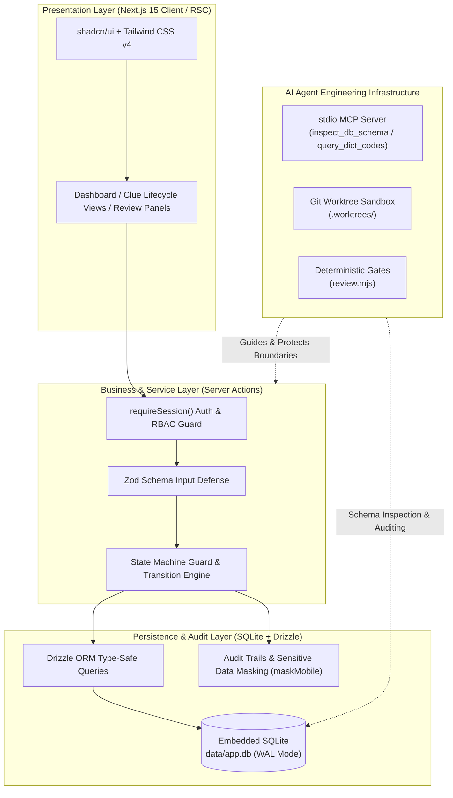

<div align="center">

# 🔍 clue-lens

### A Production-Grade Spec-Driven Development (SDD) & AI Agent Governance Sandbox for Full-Stack Engineering
**Next.js 15 (App Router) + Drizzle ORM + SQLite (WAL) + Better Auth + Tailwind CSS v4 + shadcn/ui + Zod**

[English](README_en.md) | [简体中文](README.md)

<br/>

[](LICENSE)
[](https://nextjs.org/)
[](https://react.dev/)
[](https://www.typescriptlang.org/)
[](https://orm.drizzle.team/)
[](https://www.sqlite.org/)
[](https://tailwindcss.com/)
[](#-3-native-model-context-protocol-mcp-infrastructure)
[](#-1-five-stage-sdd-closed-loop-pipeline)
[](#-4-git-worktree-physical-isolation-sandbox)

</div>

---

## 💡 Why Spec-Driven Development (SDD)?

> *"In the era of AI Coding, the marginal cost of writing code approaches zero, but the cost of fixing hallucinated logic and untangling spaghetti architectures is growing exponentially."*

Today, 99% of AI coding tutorials and boilerplates remain stuck in the toy-like stage of **"Vibe Coding"** (chat-based prompt-and-pray programming). When applied to real-world, complex enterprise applications, this pattern inevitably collapses:

1. **Context Black Hole & Hallucination Cascades**: As conversational turns multiply, oversized context windows cause LLMs to forget earlier architectural constraints and fabricate non-existent API endpoints or database columns.
2. **Absence of a Single Source of Truth (SSOT)**: Requirements remain fragmented across dozens of unstructured conversational messages. Tests generated by AI blindly validate erroneous logic, trapping projects in a vicious circle where "both the test and the code are wrong."
3. **Silent Architectural Degradation**: LLMs lack an intrinsic understanding of layered boundaries, easily bypassing authentication, omitting input validation, and ignoring state machine guards.
4. **Agent-Human Collisions**: When multiple agents or developers run concurrently in the same workspace, file overwrites, Git index deadlocks, and SQLite `database is locked` errors occur constantly.

### 🌟 The Solution: Spec-Driven Development (SDD)

**clue-lens** is an end-to-end full-stack reference implementation demonstrating how to build enterprise software with **Spec-Driven Development (SDD) and rigorous AI Agent Governance**:

```mermaid
flowchart LR
    A["Raw Req<br/>Pain Points"] --> B["Clarification<br/>Scope Defense"]
    B --> C["Requirements<br/>Formal EARS Spec"]
    C --> D["Design<br/>Tech Architecture"]
    D --> E["Tasks<br/>Atomic Actions"]
    E --> F["Implementation<br/>Isolated Worktree"]
    F --> G["Review Gates<br/>Deterministic Audits"]

    style A fill:#f1f5f9,stroke:#64748b,stroke-width:1px
    style B fill:#e0f2fe,stroke:#0284c7,stroke-width:1px
    style C fill:#dbeafe,stroke:#2563eb,stroke-width:2px
    style D fill:#fef3c7,stroke:#d97706,stroke-width:1px
    style E fill:#fae8ff,stroke:#a855f7,stroke-width:1px
    style F fill:#dcfce7,stroke:#16a34a,stroke-width:2px
    style G fill:#fee2e2,stroke:#dc2626,stroke-width:2px
```



- **Spec-First Principle**: No formal specifications without prior business clarification; no architectural designs without confirmed specs; no task breakdown without approved designs; and zero merges without automated gate verification.
- **Traceable SSOT**: Formalize all requirements using EARS (Easy Approach to Requirements Syntax) criteria and deterministic state machines, ensuring human developers and AI coding agents stay strictly aligned.

---

## 🔥 5 Core Architectural Moats

### 🛡️ 1. Five-Stage SDD Closed-Loop Pipeline
In the [`spec/`](file:///Users/yubin/workspaces/2026product/clue-lens/spec) directory, every feature evolves through five transparent stages:
- **Stage 1: Requirement Capture (`raw-requirements.md`)**: Records rough user pain points and vision.
- **Stage 2: Scope Clarification (`clarification.md`)**: Multi-turn questioning resolves edge cases, roles, and business boundary decisions.
- **Stage 3: Formal Specification (`requirements.md`)**: The core Single Source of Truth (SSOT), featuring EARS acceptance criteria, SLAs, and formal state transition rules.
- **Stage 4: Technical Design (`design.md`)**: Synthesizes schemas, Server Actions contracts, and UI topologies aligned with system guidelines.
- **Stage 5: Task Breakdown (`tasks.md`)**: Deconstructs designs into atomic tasks with explicit execution dependencies and automated verification commands.

Includes 6 ready-to-use SDD skills: `spec-clarification`, `spec-requirements`, `spec-design`, `spec-tasks`, `spec-impl`, and `spec-review`.

### 📋 2. Tiered AI Agent Governance & Progressive Disclosure
Dumping tens of thousands of lines of instructions into an LLM's context window degrades performance. We employ **Progressive Rule Disclosure**:
- **Master Manifest [AGENTS.md](file:///Users/yubin/workspaces/2026product/clue-lens/AGENTS.md)**: Declares overarching architectural boundaries, security baselines, and rule indexing.
- **On-Demand [rules/](file:///Users/yubin/workspaces/2026product/clue-lens/rules)**: 8 modular domain rules (Architecture, Database, Drizzle ORM, Server Actions, Coding Style, Quality & Testing, Auth & Security, Worktree Workflow) loaded only when touching relevant files.
- **Uncompromising Architectural Red Lines**:
  1. *Session & Tenant Isolation*: Explicit `requireSession()` guard on all data actions.
  2. *Zod Boundary Defense*: Strict `safeParse` validation on all external payloads before entering business layers.
  3. *Zero String SQL*: 100% type-safe Drizzle ORM API calls; parameterized interpolation only.
  4. *Native Module Guard*: `better-sqlite3` handle recycling to prevent memory and connection leaks under Next.js HMR.

### 🔌 3. Native Model Context Protocol (MCP) Infrastructure
Empowers AI coding assistants (Claude Code, Cursor, Windsurf, Antigravity) with standard MCP stdio services:
- **Read-Only Schema Inspection (`inspect_db_schema`)**: Allows agents to inspect real table DDLs, column types, foreign keys, and indexes, eliminating runtime failures caused by AI guessing column names.
- **Business Dictionary Query (`query_dict_codes`)**: Standardized lookup for system statuses, roles, and exception tags.
- **Strict RBAC & Confidentiality**: Blacklists sensitive tables (e.g., credentials) and logs all tool invocations for security auditing.

### 🌳 4. Git Worktree Physical Isolation Sandbox
Eliminates file conflicts and SQLite lockups (`database is locked`) during multi-agent or agent-human concurrent development:
- CLI utility: `node scripts/agent/worktree.mjs new <slug>`
- **Physical Isolation**: Spawns an isolated directory under `.worktrees/clue-lens-<slug>` on an isolated Git branch.
- **Private Database Sandbox**: Automatically duplicates an isolated SQLite file (`data/app.db`) for private runtime testing.
- **Zero-Latency Dependency Sharing**: Symlinks the root `node_modules`—no redundant `npm install` needed.
- **Strict Fast-Forward Merges**: Validates all checks and performs `--ff-only` merges into `main`.

### 🎯 5. Deterministic Review & Verification Gates
Replaces probabilistic "LLM reviewing its own code" with deterministic AST and static analysis:
- Unified command: `npm run review` (powered by `scripts/review.mjs`).
- Chained checks: TypeScript static verification, architectural consistency scanner (`check-consistency.mjs`), Server Actions security AST scanner (`check-security.mjs`), and high-confidence secret leak scanner (`check-secrets.mjs`).
- Structured audit reports saved to `evidence/`; failures block branch merges immediately.

---

## 🏗️ Architecture & Interaction Topology



---

## 🛠️ Tech Stack & Philosophy

A 100% modern, full-stack TypeScript/Node.js stack with **zero external middleware dependencies**—runs out-of-the-box:

| Layer | Technology | Key Rationale |
|---|---|---|
| **Framework** | Next.js 15 (App Router) + React 19 | Modern React Server Components (RSC) & ultra-fast Turbopack hot reloading |
| **Database** | SQLite (better-sqlite3) | Local single-file database with WAL mode and foreign key cascades |
| **ORM** | Drizzle ORM | Zero-runtime overhead, lightweight, full TypeScript schema type inference |
| **Authentication** | Better Auth | Modern full-stack session management with role-based access control (RBAC) |
| **Design System** | Tailwind CSS v4 + shadcn/ui | Radix UI primitives and utility-first styling; avoids unstyled native HTML |
| **Data Validation** | Zod 4 | End-to-end type inference and robust input validation |
| **Agent Protocol** | Model Context Protocol (MCP) | Industry-standard protocol for agentic metadata inspection |

---

## 🚀 Quick Start

### Prerequisites
- **Node.js**: `>= 20.12`
- **OS**: macOS / Linux / Windows (Platform-agnostic CLI)

### Installation & Setup
```bash
# 1. Clone the repository
git clone https://github.com/your-username/clue-lens.git
cd clue-lens

# 2. Install dependencies
npm install

# 3. Initialize environment (generates secret keys in .env, sets up SQLite DB & activates Git hooks)
npm run setup

# 4. Start local development server
npm run dev
```

Open `http://localhost:3000` in your browser. Register an account to explore the complete business lifecycle (clue intake, state machine transitions, and audit logs).

---

## 💻 Essential Commands

| Command | Description |
|---|---|
| `npm run dev` | Start development server with Turbopack |
| `npm run build` | Build Next.js application for production |
| `npm run typecheck` | Run zero-tolerance TypeScript typecheck |
| `npm run review` | Execute deterministic pre-merge review gates |
| `npm run check:consistency` | Verify directory structure and schema naming consistency |
| `npm run check:security` | Statically scan Server Actions for auth guards and boundaries |
| `npm run db:studio` | Open visual Drizzle Studio to inspect SQLite data |
| `npm run db:push` | Directly apply `schema.ts` changes to SQLite database |
| `npm run db:generate` | Generate versioned SQL migration scripts |
| `npm run mcp` | Launch local stdio Model Context Protocol (MCP) server |
| `npm run test:mcp` | Validate MCP contract and schema inspection tools |

---

## 📂 Project Structure & SDD Layout

```text
clue-lens/
├── AGENTS.md                  # Master entry point for AI governance, red lines & rule indexing
├── ARCHITECTURE.md            # System SSOT navigation map (ER diagrams, sequence flows)
├── LICENSE                    # MIT Open Source License
├── rules/                     # Actionable domain specifications
│   ├── 01-project-architecture.md
│   ├── 02-database-design.md
│   ├── 03-drizzle-convention.md
│   ├── 04-server-actions-convention.md
│   ├── 05-coding-style.md
│   ├── 06-test-and-quality-convention.md
│   ├── 07-security-and-auth.md
│   └── 08-worktree-workflow.md
├── spec/                      # Specification Center (Single Source of Truth)
│   ├── README.md              # 5-stage SDD workflow guide
│   └── clue-lens/             # Feature specs (raw -> clarification -> requirements -> design -> tasks)
├── .agents/                   # Agent skills center & execution manifest
│   ├── agent-manifest.yml     # Role boundaries and IO contracts
│   └── skills/                # 6 standard SDD skills (clarification, requirements, design, tasks, impl, review)
├── scripts/                   # Automated operations, gates, and agent workflow scripts
│   ├── review.mjs             # Unified gate runner (npm run review, supports --staged)
│   ├── review-checks.list     # Configurable checks manifest
│   ├── gates/                 # Gate verification scripts (consistency, security, secrets, build)
│   ├── agent/                 # Agent orchestration and isolation (worktree.mjs / agent-run.mjs)
│   └── mcp/                   # MCP stdio server and testing client
├── evidence/                  # Machine review audit logs
├── src/                       # Application source code
│   ├── app/                   # App Router pages and Server Actions
│   ├── components/            # shadcn/ui components & compound business views
│   ├── db/                    # Drizzle ORM Schema & SQLite connection
│   └── lib/                   # Better Auth, session guards, and Zod schemas
└── data/                      # Local SQLite storage (app.db, auto-ignored in git)
```

---

## ❓ FAQ

### Q: How does SDD differ from TDD (Test-Driven Development)?
> **A:** TDD verifies whether the code works according to the test expectations, but **it cannot guarantee that the test itself represents the correct business intent**. In AI coding, asking LLMs to generate tests first often leads to hallucinated tests validating hallucinated logic.  
> SDD ensures you are building the right thing from the outset. By formalizing clarification outcomes and EARS criteria into an immutable specification, tests anchor to verified specs, eliminating requirement drift.

### Q: Why is Git Worktree isolation essential for AI Coding?
> **A:** In traditional single-working-tree setups, concurrent agents or human-agent collaboration lead to silent file overwrites, Git index corruption, and SQLite `database is locked` errors. `worktree.mjs` provides an isolated directory, an independent Git branch, and a private SQLite clone for each task.

### Q: How can I adopt this SDD paradigm in my own project?
> **A:** The system is intentionally modular:
> 1. Copy `rules/` and `AGENTS.md` to your repository, tuning boundaries for your tech stack.
> 2. Mount `spec/` guidelines and `.agents/skills` to your AI coding agents (Claude Code / Cursor / Windsurf).
> 3. Adopt `scripts/agent/worktree.mjs` and `scripts/review.mjs` in your CI/CD and pre-commit pipelines.

---

## 🤝 Contributing & License

Contributions, discussions, and feature requests are welcome!
Licensed under the [MIT License](LICENSE).
