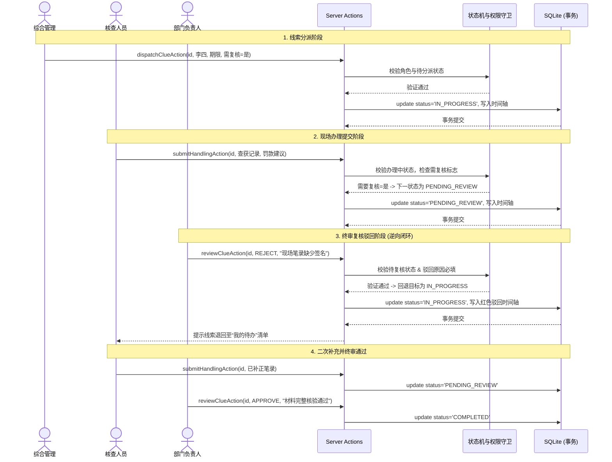

# 专卖监管线索分析与闭环管理系统技术设计说明书

> **对应需求:** [`spec/clue-lens/requirements.md`](file:///Users/yubin/workspaces/2026product/clue-lens/spec/clue-lens/requirements.md)  
> **设计级别:** 标准设计  
> **判定依据:** 涉及跨角色工作流状态机跃迁（待分派 $\rightarrow$ 办理中 $\rightarrow$ 待复核 $\rightarrow$ 已完成 $\rightarrow$ 已关闭）、复核驳回退回闭环、Excel 台账流式解析与 Upsert 跨表事务、确定性 5 维异常计算规则引擎、双模处置建议生成策略以及双形态报告导出。

---

## 一、方案概述

### 1.1 业务目标

1. **台账集中解析与增量更新**：通过上传脱敏 Excel/CSV 台账文件，以“线索编号”为唯一键执行行级容错 Upsert，解决台账分散不一问题；
2. **态势全景透视与多维复合筛选**：秒级呈现宏观大盘（总量、高风险、待办、超期及类型 TOP 榜），支持区域/时间/类型/状态多维联动过滤；
3. **确定性异常识别打标**：内置规则引擎秒级完成重复对象、区域集中、金额异常、超期及高风险未分派 5 维预警标签计算；
4. **双模辅助处置建议**：默认离线专家决策树秒级生成处置方案（100% 离线开箱可用），可选切换 LLM 深度研判；
5. **跨角色全生命周期流转闭环**：支持综合管理分派、核查人员办理、部门负责人复核通过与驳回退回，全链条时间轴沉淀；
6. **多形态报告导出**：一键导出 Excel 多 Sheet 统计台账与 Markdown/网页打印研判初稿。

### 1.2 实现范围

- **本次实现**：
  1. 专卖监管线索主表 (`monopoly_clues`)、时间轴日志表 (`clue_timeline_logs`) 与安全审计日志表 (`system_audit_logs`)；
  2. Excel 解析导入引擎与基于线索编号的 Upsert 事务写入（行级错误隔离）；
  3. 首页综合态势大盘组件与线索台账多维复合筛选大盘；
  4. 规则引擎自动异常识别模块（`detectAnomalies`）；
  5. 双模处置建议生成策略（`RuleBasedEngine` + 可选 `LLMEngine`）；
  6. 线索分派、办结填报、复核通过、复核驳回退回、归档关闭 Server Actions 与状态守卫；
  7. 线索详情流转时间轴 (Timeline) 组件；
  8. Excel 多 Sheet 导出与 Markdown 报告导出服务；
  9. 顶部快捷切换演示角色模式（综合管理、核查人员、部门负责人、情报分析、监督管理）。
- **不在本次实现**：外部政务专卖专网系统双向实时同步、短信外呼硬件对接、音视频超大附件存储、OCR 扫描识别。
- **复用能力**：Better Auth 会话校验 (`requireSession`)、Drizzle ORM 类型安全 API、Tailwind CSS v4 + shadcn/ui 组件库、Zod 表单验证。
- **关键约束**：纯 TypeScript/Node.js 全栈实现；SQLite WAL 模式与外键级联；Server Actions 强制参数防卫与状态机守卫拦截。

### 1.3 总体实现说明

采用 **Next.js 15 App Router** 架构：
- **前端表现层**：页面为 React Server Components (RSC)，负责服务端初次加载数据；客户端组件（筛选栏、导入弹窗、操作卡片、时间轴）负责交互与状态切换。
- **服务端接口层**：采用 Next.js 15 **Server Actions** 契约，统一经由 `requireSession()` 守卫和 `zod.safeParse` 参数防卫。
- **业务逻辑层**：异常识别引擎、处置建议生成器、Excel 解析器均封装为独立高内聚纯函数模块，具备独立的聚焦单元测试。
- **数据持久层**：基于 Drizzle ORM 操作本地 SQLite (`data/app.db`)，写操作通过 `db.transaction()` 保证主表、时间轴日志与审计日志的 ACID 原子一致性。

### 1.4 复用能力接入契约

| 复用能力 | 适用场景 | 接入入口 | 关键契约 | 选择规则 | 事务/调用边界 | 失败行为与限制 |
| --- | --- | --- | --- | --- | --- | --- |
| **Better Auth 会话守卫** | 保护所有 Server Actions | `const session = await requireSession()` | 返回当前已认证会话 `{ user: { id, name, email } }` | 替代无主查询；全系统入口必调 | 方法入口执行，不参与外层事务 | 未登录抛出 `UnauthorizedError` 或返回 `{ ok: false, error: "未登录" }` |
| **Drizzle 事务机制** | 跨表状态流转、Upsert 导入 | `await db.transaction(async (tx) => { ... })` | 传入原子事务上下文 `tx`，内部所有 `tx.insert/update` 统一提交或回滚 | 涉及线索状态修改与时间轴插入时必用 | 包裹主表修改、时间轴插入与审计记录 | 抛出异常自动回滚，数据库无残留半更新脏数据 |
| **Zod 输入校验守卫** | Server Actions 入参防卫 | `schema.safeParse(input)` | 返回 `{ success: true, data }` 或 `{ success: false, error }` | 严禁信任客户端传入的任意数据 | 在进入业务处理函数的第一行调用 | 校验失败统一返回 `{ ok: false, error: formatZodError(error) }` |

```typescript
// 最小接入示例：统一 Server Action 契约模式
export async function dispatchClueAction(input: unknown) {
  const session = await requireSession(); // 1. 身份守卫
  const parsed = dispatchInputSchema.safeParse(input); // 2. 入参防卫
  if (!parsed.success) {
    return { ok: false, error: parsed.error.issues[0].message };
  }
  
  return await db.transaction(async (tx) => { // 3. 事务边界
    // 状态守卫与流转写入
    return { ok: true };
  });
}
```

---

## 二、源代码文件清单

### 2.1 前端文件清单

| 类型 | 文件路径 | 主要职责 | 关联需求 |
| --- | --- | --- | --- |
| 修改 | `src/app/(app)/page.tsx` | 综合态势大盘入口，聚合卡片、TOP 榜、区域分布图 | 需求 2, 需求 3 |
| 新增 | `src/app/(app)/clues/page.tsx` | 线索台账大盘入口，支持表格/卡片双视图与分页 | 需求 2, 需求 3 |
| 新增 | `src/app/(app)/clues/[id]/page.tsx` | 线索详情工作台：基础信息、处置建议卡片、时间轴 | 需求 4, 需求 5 |
| 新增 | `src/components/clues/filter-bar.tsx` | 多维复合筛选栏（区域/时间/类型/风险/状态/异常标签） | 需求 2 |
| 新增 | `src/components/clues/import-modal.tsx` | Excel 台账文件上传解析弹窗与行级容错日志反馈 | 需求 1 |
| 新增 | `src/components/clues/dispatch-dialog.tsx` | 综合管理人员分派责任部门/人/时限/复核标志弹窗 | 需求 5 |
| 新增 | `src/components/clues/handling-form.tsx` | 核查执法人员填报核查日期、结论与处置措施表单 | 需求 5 |
| 新增 | `src/components/clues/review-dialog.tsx` | 部门负责人复核通过与驳回退回弹窗（驳回原因必填） | 需求 5 |
| 新增 | `src/components/clues/advisory-card.tsx` | 双模处置建议生成卡片（专家规则 + 可选 AI 研判） | 需求 4 |
| 新增 | `src/components/clues/timeline-view.tsx` | 线索全生命周期流转时间轴（记录角色、动作、前后状态） | 需求 5 |
| 新增 | `src/components/clues/export-dropdown.tsx` | 导出下拉菜单（Excel 多 Sheet 台账与 Markdown 报告） | 需求 6 |
| 新增 | `src/components/role-switcher.tsx` | 导航栏快捷切换演示角色组件（驱动权限自适应） | 需求 5 |

### 2.2 后端与核心逻辑文件清单

| 类型 | 文件路径 | 主要职责 | 关联需求 |
| --- | --- | --- | --- |
| 修改 | `src/db/schema.ts` | 专卖监管线索主表、时间轴日志表、审计日志表 Drizzle 规约 | 全部需求 |
| 新增 | `src/lib/validations/clue.ts` | 集中定义线索录入、分派、办理、复核等 Zod 校验模式 | 需求 1, 需求 5 |
| 新增 | `src/lib/anomaly-detector.ts` | 确定性 5 维异常计算规则引擎（重复、区域集中、超期等） | 需求 3 |
| 新增 | `src/lib/advisory-engine.ts` | 双模处置建议生成策略（专家规则树 + 可选 LLM 适配器） | 需求 4 |
| 新增 | `src/lib/excel-parser.ts` | Excel/CSV 文件解析、字段对齐与行级容错 Upsert 处理 | 需求 1 |
| 新增 | `src/lib/report-exporter.ts` | 结构化 Markdown 研判初稿与多 Sheet Excel 文件生成服务 | 需求 6 |
| 修改 | `src/app/actions/clues.ts` | 封装线索导入、分派、办理、复核、归档等完整 Server Actions | 全部需求 |

### 2.3 测试与脚本文件清单

| 类型 | 文件路径 | 主要职责 | 关联需求 |
| --- | --- | --- | --- |
| 新增 | `src/tests/clue-workflow.test.ts` | 端到端全状态机流转闭环与逆向驳回自动化测试 | 需求 5 |
| 新增 | `src/tests/anomaly-detector.test.ts` | 异常识别规则引擎阈值判定单元测试 | 需求 3 |
| 新增 | `src/tests/excel-parser.test.ts` | Excel 解析格式容错与 Upsert 数据一致性测试 | 需求 1 |

---

## 三、数据库 DDL 设计

### 3.1 表与关系说明

| 表名 | 用途 | 主键 | 关键关系 | 数据生命周期 |
| --- | --- | --- | --- | --- |
| `monopoly_clues` | 专卖监管线索主表 | `id` (UUID) | `clue_no` 唯一索引；`user_id` 关联 `user.id` | 导入/创建新增，分派/办理/复核更新，终态关闭归档 |
| `clue_timeline_logs` | 线索流转时间轴历史表 | `id` (UUID) | `clue_id` 外键级联 `monopoly_clues.id` | 每次流转操作追加一条记录，永久物理留痕 |
| `system_audit_logs` | 系统全局安全审计日志表 | `id` (UUID) | 逻辑记录 `target_id` | 敏感操作（导入、分派、复核、导出）追加，只读不可删 |

### 3.2 可执行 SQLite DDL

```sql
-- 1. 专卖监管线索主表
CREATE TABLE IF NOT EXISTS monopoly_clues (
    id TEXT PRIMARY KEY,
    clue_no TEXT NOT NULL UNIQUE,
    discovery_date TEXT NOT NULL,
    region TEXT NOT NULL,
    source TEXT NOT NULL,
    type TEXT NOT NULL,
    target_name TEXT NOT NULL,
    risk_level TEXT NOT NULL,           -- '高', '中', '低'
    amount REAL NOT NULL DEFAULT 0.0,
    department TEXT,
    handler TEXT,
    deadline TEXT,
    need_review INTEGER NOT NULL DEFAULT 0, -- 0: 否, 1: 是
    status TEXT NOT NULL DEFAULT 'PENDING_ASSIGN', -- 'PENDING_ASSIGN','IN_PROGRESS','PENDING_REVIEW','COMPLETED','CLOSED'
    check_date TEXT,
    check_result TEXT,
    measures TEXT,
    review_comment TEXT,
    close_reason TEXT,
    user_id TEXT NOT NULL REFERENCES user(id) ON DELETE CASCADE,
    created_at INTEGER NOT NULL,
    updated_at INTEGER NOT NULL
);

CREATE INDEX IF NOT EXISTS idx_clues_clue_no ON monopoly_clues(clue_no);
CREATE INDEX IF NOT EXISTS idx_clues_region ON monopoly_clues(region);
CREATE INDEX IF NOT EXISTS idx_clues_type ON monopoly_clues(type);
CREATE INDEX IF NOT EXISTS idx_clues_status ON monopoly_clues(status);
CREATE INDEX IF NOT EXISTS idx_clues_target_name ON monopoly_clues(target_name);
CREATE INDEX IF NOT EXISTS idx_clues_discovery_date ON monopoly_clues(discovery_date);

-- 2. 线索流转时间轴历史表
CREATE TABLE IF NOT EXISTS clue_timeline_logs (
    id TEXT PRIMARY KEY,
    clue_id TEXT NOT NULL REFERENCES monopoly_clues(id) ON DELETE CASCADE,
    operator_role TEXT NOT NULL,
    operator_name TEXT NOT NULL,
    action TEXT NOT NULL,               -- 'IMPORT', 'DISPATCH', 'SUBMIT', 'APPROVE', 'REJECT', 'CLOSE'
    from_status TEXT,
    to_status TEXT NOT NULL,
    comment TEXT,
    created_at INTEGER NOT NULL
);

CREATE INDEX IF NOT EXISTS idx_timeline_clue_id ON clue_timeline_logs(clue_id);

-- 3. 系统全局安全审计日志表
CREATE TABLE IF NOT EXISTS system_audit_logs (
    id TEXT PRIMARY KEY,
    trace_id TEXT NOT NULL,
    operator_role TEXT NOT NULL,
    operator_id TEXT NOT NULL,
    action TEXT NOT NULL,
    target_id TEXT,
    details TEXT,
    ip_address TEXT,
    created_at INTEGER NOT NULL
);

CREATE INDEX IF NOT EXISTS idx_audit_trace ON system_audit_logs(trace_id);
```

### 3.3 Drizzle Schema 定义映射 (`src/db/schema.ts`)

```typescript
export const monopolyClues = sqliteTable(
  "monopoly_clues",
  {
    id: text("id").primaryKey().$defaultFn(() => crypto.randomUUID()),
    clueNo: text("clue_no").notNull().unique(),
    discoveryDate: text("discovery_date").notNull(),
    region: text("region").notNull(),
    source: text("source").notNull(),
    type: text("type").notNull(),
    targetName: text("target_name").notNull(),
    riskLevel: text("risk_level").notNull(),
    amount: integer("amount").notNull().default(0),
    department: text("department"),
    handler: text("handler"),
    deadline: text("deadline"),
    needReview: integer("need_review", { mode: "boolean" }).notNull().default(false),
    status: text("status").notNull().default("PENDING_ASSIGN"),
    checkDate: text("check_date"),
    checkResult: text("check_result"),
    measures: text("measures"),
    reviewComment: text("review_comment"),
    closeReason: text("close_reason"),
    userId: text("user_id").notNull().references(() => user.id, { onDelete: "cascade" }),
    createdAt: integer("created_at", { mode: "timestamp" }).notNull().$defaultFn(() => new Date()),
    updatedAt: integer("updated_at", { mode: "timestamp" }).notNull().$defaultFn(() => new Date()),
  },
  (t) => [
    index("idx_clues_clue_no").on(t.clueNo),
    index("idx_clues_region").on(t.region),
    index("idx_clues_type").on(t.type),
    index("idx_clues_status").on(t.status),
    index("idx_clues_target_name").on(t.targetName),
  ]
);
```

---

## 四、核心服务实现伪代码 (TypeScript)

### 4.1 异常识别规则引擎 (`src/lib/anomaly-detector.ts`)

```typescript
export interface AnomalyTag {
  code: string;
  label: string;
  type: "danger" | "warning" | "info";
  detail?: string;
}

export function detectAnomalies(
  clue: MonopolyClue,
  targetFrequencyMap: Map<string, number>,
  region30DaysCountMap: Map<string, number>,
  regionType30DaysCountMap: Map<string, number>
): AnomalyTag[] {
  const tags: AnomalyTag[] = [];
  const nowStr = new Date().toISOString().split("T")[0];

  // 1. 重复出现对象判定 (全库关联 >= 2)
  const count = targetFrequencyMap.get(clue.targetName) || 1;
  if (count >= 2) {
    tags.push({ code: "REPEAT_TARGET", label: `重复对象(${count}次)`, type: "danger" });
  }

  // 2. 区域短期集中判定 (近30天区域线索 >= 5)
  if ((region30DaysCountMap.get(clue.region) || 0) >= 5) {
    tags.push({ code: "REGION_CONCENTRATED", label: "区域集中", type: "warning" });
  }

  // 3. 同类问题连发 (近30天同区域同类型 >= 3)
  const key = `${clue.region}_${clue.type}`;
  if ((regionType30DaysCountMap.get(key) || 0) >= 3) {
    tags.push({ code: "TYPE_REPEATED", label: "同类连发", type: "warning" });
  }

  // 4. 涉案金额异常 (金额 >= 100,000 元)
  if (clue.amount >= 100000) {
    tags.push({ code: "AMOUNT_ABNORMAL", label: "金额异常", type: "danger", detail: `涉案￥${clue.amount}` });
  }

  // 5. 办理超期预警 (未完成且当前日期 > 办理期限)
  if (clue.deadline && !["COMPLETED", "CLOSED"].includes(clue.status) && nowStr > clue.deadline) {
    tags.push({ code: "OVERDUE", label: "办理超期", type: "danger" });
  }

  // 6. 高风险未分派
  if (clue.riskLevel === "高" && clue.status === "PENDING_ASSIGN") {
    tags.push({ code: "HIGH_RISK_UNASSIGNED", label: "高危待派", type: "danger" });
  }

  return tags;
}
```

### 4.2 审批复核与驳回流转 Server Action (`src/app/actions/clues.ts`)

```typescript
export async function reviewClueAction(input: unknown) {
  const session = await requireSession();
  const parsed = reviewInputSchema.safeParse(input);
  if (!parsed.success) return { ok: false, error: parsed.error.issues[0].message };

  const { clueId, action, comment, operatorRole } = parsed.data;

  // 角色守卫：仅部门负责人可执行复核
  if (operatorRole !== "部门负责人") {
    return { ok: false, error: "越权拦截：仅部门负责人具备复核审批权限" };
  }

  return await db.transaction(async (tx) => {
    // 状态守卫：仅待复核状态允许复核
    const [existing] = await tx.select().from(monopolyClues).where(eq(monopolyClues.id, clueId)).limit(1);
    if (!existing) return { ok: false, error: "线索不存在" };
    if (existing.status !== "PENDING_REVIEW") {
      return { ok: false, error: `状态机守卫拦截：当前状态为[${existing.status}]，不可执行复核` };
    }

    if (action === "REJECT" && (!comment || comment.trim().length === 0)) {
      return { ok: false, error: "复核驳回时必须录入驳回原因" };
    }

    const nextStatus = action === "APPROVE" ? "COMPLETED" : "IN_PROGRESS";
    const actionLabel = action === "APPROVE" ? "APPROVE" : "REJECT";

    // 1. 更新主表
    await tx.update(monopolyClues).set({
      status: nextStatus,
      reviewComment: comment || null,
      updatedAt: new Date(),
    }).where(eq(monopolyClues.id, clueId));

    // 2. 插入时间轴日志
    await tx.insert(clueTimelineLogs).values({
      clueId,
      operatorRole: "部门负责人",
      operatorName: session.user.name,
      action: actionLabel,
      fromStatus: "PENDING_REVIEW",
      toStatus: nextStatus,
      comment: comment || (action === "APPROVE" ? "复核通过" : "复核驳回"),
      createdAt: new Date(),
    });

    // 3. 记录全局审计日志
    await tx.insert(systemAuditLogs).values({
      traceId: crypto.randomUUID(),
      operatorRole: "部门负责人",
      operatorId: session.user.id,
      action: `CLUE_${actionLabel}`,
      targetId: clueId,
      details: JSON.stringify({ from: "PENDING_REVIEW", to: nextStatus, comment }),
      createdAt: new Date(),
    });

    return { ok: true, nextStatus };
  });
}
```

---

## 五、复杂流程时序

### 5.1 全流程闭环与逆向驳回时序图



---

## 六、接口与页面协作

### 6.1 Server Actions 签名清单

| 函数名称 | 入参结构 | 返回结构 | 权限/守卫 |
| --- | --- | --- | --- |
| `importCluesAction` | `FormData` (Excel/CSV 流) | `{ ok: boolean, imported: number, skipped: number, errors: any[] }` | 综合管理人员；行级容错 Upsert |
| `getDashboardDataAction` | `{ region?: string, type?: string, risk?: string }` | `{ stats: StatsObj, clues: ClueWithTags[] }` | 全员可见；实时计算 5 维 Tag |
| `generateAdvisoryAction` | `{ clueId: string, useAi?: boolean }` | `{ ok: boolean, advisory: AdvisoryObj, source: string }` | 规则秒级响应；AI 异常无缝降级 |
| `dispatchClueAction` | `{ clueId: string, department: string, handler: string, deadline: string, needReview: boolean }` | `{ ok: boolean, error?: string }` | 综合管理人员；待分派状态守卫 |
| `submitHandlingAction` | `{ clueId: string, checkDate: string, checkResult: string, measures: string }` | `{ ok: boolean, nextStatus: string }` | 核查人员；办理中状态守卫 |
| `reviewClueAction` | `{ clueId: string, action: "APPROVE"\|"REJECT", comment?: string, operatorRole: string }` | `{ ok: boolean, nextStatus: string }` | 部门负责人；待复核守卫；驳回必填 |
| `closeClueAction` | `{ clueId: string, closeReason?: string, operatorRole: string }` | `{ ok: boolean }` | 部门负责人；已完成状态守卫 |
| `exportCluesAction` | `{ filterCriteria: any, format: "XLSX"\|"MARKDOWN" }` | `{ ok: boolean, fileContent: string, filename: string }` | 全员允许导出 |

---

## 七、验证重点与风险

### 7.1 验证重点

| 验证项 | 验证内容与判据 | 关联需求与场景 |
| --- | --- | --- |
| **Excel 容错 Upsert** | 导入重复编号线索执行属性更新且时间轴不丢失；错误行跳过并弹窗提示日志明细 | 需求 1, 需求 5 |
| **异常规则实时命中** | 重复经营主体出现 2 次以上立即出现“重复对象”徽章；超期线索呈现红色标牌 | 需求 3 |
| **正向黄金流转闭环** | 导入 $\rightarrow$ 分派 $\rightarrow$ 办理 $\rightarrow$ 复核通过 $\rightarrow$ 归档，全流程状态顺畅流转并完整沉淀时间轴 | 需求 5 (GWT 场景 1) |
| **逆向复核驳回闭环** | 待复核线索驳回强退回办理中，并拦截空驳回理由；时间轴新增驳回留痕记录 | 需求 5 (GWT 场景 2) |
| **双模处置建议降级** | 离线环境下秒级输出专家模板；配置 AI 密钥时输出智能扩展研判建议 | 需求 4 |

### 7.2 风险与缓解对策

- **风险 1：客户端伪造角色越权调用**
  - **缓解对策**：前端仅做视图级自适应适配；所有 Server Actions 强制在服务端对 `operatorRole` 与会话状态进行交叉二次校验，非法调用坚决阻断。
- **风险 2：大文件 Excel 解析阻塞主线程**
  - **缓解对策**：选用纯 TS/JS 轻量流式解析库，前端限制单次上传文件体积 $\le 10\text{MB}$，单批次处理 1,000 条数据耗时控制在 $1\text{秒}$ 内部。
