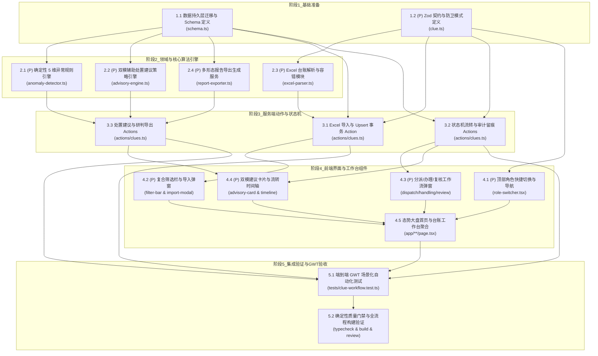

# 专卖监管线索分析与闭环管理系统实现任务清单 (tasks.md)

- **任务清单级别**：标准设计
- **判定依据**：涉及跨角色全生命周期状态机流转、复核驳回退回闭环、Excel 流式解析与基于线索编号的 Upsert、确定性 5 维异常计算规则引擎、双模处置建议策略以及端到端多形态报告导出。

---

## 一、任务依赖 DAG 拓扑图 (Dependency Directed Acyclic Graph)

---

## 二、原子化实现任务待办清单 (Work Breakdown Structure)

### 阶段 1：基础准备 (Foundation & Schema)

- [x] 1.1 数据持久层迁移与 Schema 定义
  - [x] 在 `src/db/schema.ts` 中新增专卖监管线索主表 `monopolyClues`，设置唯一主键 `id` 与业务唯一索引 `clueNo`
  - [x] 定义线索流转时间轴历史表 `clueTimelineLogs`，配置外键级联删除（`onDelete: "cascade"`）
  - [x] 定义系统安全审计日志表 `systemAuditLogs`，设置链路追踪 `traceId` 索引
  - [x] 执行 DDL 迁移并在本地 SQLite (`data/app.db`) 中成功创建三张数据表与对应索引
  - _Requirements: 1.1, 5.1, 5.9_
  - _Boundary: src/db/schema.ts_

- [x] 1.2 (P) Zod 参数防卫与 TypeScript 契约定义
  - [x] 在 `src/lib/validations/clue.ts` 中定义 `importClueRowSchema`（单行数据类型与日期格式校验）
  - [x] 定义 `dispatchClueSchema`（线索ID、责任部门、责任人、时限格式 `YYYY-MM-DD`、需复核标志）
  - [x] 定义 `submitHandlingSchema`（核查日期、核查结果必填、处置措施）与 `reviewClueSchema`（审批动作 `APPROVE/REJECT`、驳回原因校验）
  - [x] 导出强类型 DTO 并在参数校验失败时输出统一的友好错误提示
  - _Requirements: 1.3, 5.2, 5.7_
  - _Boundary: src/lib/validations/clue.ts_

---

### 阶段 2：领域与核心算法引擎 (Domain & Core Logic)

- [x] 2.1 (P) 确定性 5 维异常识别规则引擎
  - [x] 在 `src/lib/anomaly-detector.ts` 中实现纯函数 `detectAnomalies(clue, statsMap)`
  - [x] 编码实现 5 维阈值逻辑：重复对象（关联 $\ge 2$条）、区域集中（30天 $\ge 5$条）、同类连发（30天 $\ge 3$条）、涉案金额（$\ge 100,000$元）、办理超期（当前日期 $>$ 办理期限且未结案）、高危待派（高风险且待分派）
  - [x] 编写 `src/tests/anomaly-detector.test.ts` 聚焦单测，验证各临界阈值判定 100% 正确命中
  - _Requirements: 3.1, 3.2, 3.3, 3.4, 3.5, 3.6_
  - _Boundary: src/lib/anomaly-detector.ts, src/tests/anomaly-detector.test.ts_
  - _Depends: 1.1_

- [x] 2.2 (P) 双模辅助处置建议策略引擎
  - [x] 在 `src/lib/advisory-engine.ts` 中内置专家规则决策树，根据“线索类型”和“风险等级”秒级输出结构化处置方案
  - [x] 实现可选大模型接口适配器，当存在环境变量 API Key 时支持一键调用深度研判
  - [x] 实现自动降级容错机制：当大模型超时或异常时无缝回退为专家规则，业务流程无感知
  - _Requirements: 4.1, 4.2, 4.3_
  - _Boundary: src/lib/advisory-engine.ts_
  - _Depends: 1.1_

- [x] 2.3 (P) Excel/CSV 台账解析与行级容错模块
  - [x] 在 `src/lib/excel-parser.ts` 中基于 `xlsx` 库实现文件流解析，自动标准化对齐表头字段
  - [x] 逐行遍历并调用 `importClueRowSchema` 进行防卫校验
  - [x] 统计有效记录与跳过记录，产出包含失败行号与原因的错误报告列表
  - [x] 编写聚焦单元测试验证异常畸形行容错跳过逻辑
  - _Requirements: 1.1, 1.2, 1.3_
  - _Boundary: src/lib/excel-parser.ts, src/tests/excel-parser.test.ts_
  - _Depends: 1.2_

- [x] 2.4 (P) 多形态报告导出生成服务
  - [x] 在 `src/lib/report-exporter.ts` 中实现多 Sheet Excel 导出（Sheet 1: 筛选后明细清单，Sheet 2: 区域/类型聚合统计表）
  - [x] 实现 Markdown 研判分析初稿模板渲染，提取宏观态势、高危重复对象、超期清单与处置建议
  - [x] 提供无依赖的 Buffer/Base64 输出，支持客户端秒级触发下载
  - _Requirements: 6.1, 6.2_
  - _Boundary: src/lib/report-exporter.ts_
  - _Depends: 1.1_

---

### 阶段 3：服务端动作与状态机 (Server Actions & State Machine)

- [x] 3.1 Excel 台账导入与 Upsert 事务 Server Action
  - [x] 在 `src/app/actions/clues.ts` 中实现 `importCluesAction(formData)`
  - [x] 会话守卫检查 `requireSession()` 并校验当前为综合管理人员
  - [x] 在 `db.transaction()` 中执行以 `clueNo` 为唯一键的批量 Upsert：已存在则更新字段并保留历史时间轴，不存在则插入新线索
  - [x] 在时间轴中批量记录“台账导入”初始事件，刷新大盘路径缓存 `revalidatePath("/clues")`
  - _Requirements: 1.1, 1.2, 1.4, 1.5_
  - _Boundary: src/app/actions/clues.ts_
  - _Depends: 1.1, 1.2, 2.3_

- [x] 3.2 全生命周期状态机流转与审计留痕 Server Actions
  - [x] 实现 `dispatchClueAction`：待分派状态守卫，校验办理期限不早于今天，更新责任部门/人并跃迁至 `IN_PROGRESS`
  - [x] 实现 `submitHandlingAction`：办理中状态守卫，登记核查结论与措施；根据 `needReview` 自动流转为 `COMPLETED` 或 `PENDING_REVIEW`
  - [x] 实现 `reviewClueAction`：待复核状态守卫，复核通过流转为 `COMPLETED`；复核驳回时强校验驳回原因必填，状态原子回退至 `IN_PROGRESS`
  - [x] 实现 `closeClueAction`：已完成状态守卫，流转为终态 `CLOSED`
  - [x] 所有状态跃迁在同一数据库事务中同步写入 `clueTimelineLogs` 与 `systemAuditLogs`
  - _Requirements: 5.1, 5.2, 5.3, 5.4, 5.5, 5.6, 5.7, 5.8, 5.9_
  - _Boundary: src/app/actions/clues.ts_
  - _Depends: 1.1, 1.2_

- [x] 3.3 处置建议与研判导出 Server Actions
  - [x] 实现 `generateAdvisoryAction(clueId, useAi)`：读取线索特征，调用建议策略引擎返回建议方案
  - [x] 实现 `getDashboardDataAction(filters)`：多条件动态构建 Drizzle 查询，实时计算 5 维预警 Tag
  - [x] 实现 `exportCluesAction(filter, format)`：调用导出服务生成文件流并返回下载契约
  - _Requirements: 2.1, 2.4, 4.1, 4.4, 6.1, 6.2_
  - _Boundary: src/app/actions/clues.ts_
  - _Depends: 2.1, 2.2, 2.4_

---

### 阶段 4：前端界面与工作台组件 (UI & Components)

- [x] 4.1 (P) 顶部演示角色快捷切换与全局导航
  - [x] 创建 `src/components/role-switcher.tsx`，支持在“综合管理、核查人员、部门负责人、情报分析、监督管理”间一键切换
  - [x] 在 `src/app/(app)/layout.tsx` 导航头中挂载角色切换组件，广播当前角色状态驱动按钮自适应
  - [x] 页面右上角展示当前操作者身份与角色徽章
  - _Requirements: 2.1, 5.1_
  - _Boundary: src/components/role-switcher.tsx, src/app/(app)/layout.tsx_
  - _Depends: 1.2_

- [x] 4.2 (P) 复合筛选栏与 Excel 导入弹窗组件
  - [x] 创建 `src/components/clues/filter-bar.tsx`，提供区域、发现时间范围、线索类型、风险等级、状态与异常标签组合筛选
  - [x] 创建 `src/components/clues/import-modal.tsx`，实现拖拽上传 Excel/CSV、模板下载链接与导入进度条
  - [x] 弹窗内展示行级容错导入反馈面板（成功条数、跳过条数及具体行号错误明细）
  - _Requirements: 1.1, 1.3, 2.1, 2.3_
  - _Boundary: src/components/clues/filter-bar.tsx, src/components/clues/import-modal.tsx_
  - _Depends: 3.1_

- [x] 4.3 (P) 分派、办理填报与审批复核工作流弹窗
  - [x] 创建 `src/components/clues/dispatch-dialog.tsx`：提供责任部门、责任人下拉、日期选择器及“是否需要复核”开关
  - [x] 创建 `src/components/clues/handling-form.tsx`：核查结果填报面板，包含日期、核查结论与处置措施录入框
  - [x] 创建 `src/components/clues/review-dialog.tsx`：复核通过确认与驳回弹窗（驳回原因输入框前端强校验必填）
  - _Requirements: 5.1, 5.2, 5.4, 5.6, 5.7_
  - _Boundary: src/components/clues/*-dialog.tsx, src/components/clues/handling-form.tsx_
  - _Depends: 3.2_

- [x] 4.4 (P) 双模建议卡片与流转时间轴组件
  - [x] 创建 `src/components/clues/advisory-card.tsx`：展示专家/AI 生成建议，支持“采纳建议”一键填入处置措施
  - [x] 创建 `src/components/clues/timeline-view.tsx`：纵向时间轴直观呈现“导入 $\rightarrow$ 分派 $\rightarrow$ 办理 $\rightarrow$ 复核/驳回 $\rightarrow$ 归档”全程操作人、状态与意见
  - [x] 驳回记录以高亮红色警示呈现，显示驳回原因与时间
  - _Requirements: 4.1, 4.4, 5.9_
  - _Boundary: src/components/clues/advisory-card.tsx, src/components/clues/timeline-view.tsx_
  - _Depends: 3.2, 3.3_

- [x] 4.5 态势大盘首页与台账工作台聚合
  - [x] 在 `src/app/(app)/page.tsx` 中服务端 RSC 加载大盘统计，渲染 4 个核心指标卡与线索类型分布柱状图
  - [x] 在 `src/app/(app)/clues/page.tsx` 中组装筛选栏、表格/卡片双视图切换、预警标签徽章与导出下拉菜单
  - [x] 在 `src/app/(app)/clues/[id]/page.tsx` 中集成线索基本信息卡片、流转操作按钮组、处置建议与时间轴
  - _Requirements: 2.1, 2.2, 2.4, 3.1, 3.4, 6.3_
  - _Boundary: src/app/(app)/**/page.tsx_
  - _Depends: 4.1, 4.2, 4.3, 4.4_

---

### 阶段 5：集成串联与端到端 GWT 场景化验收 (Verification & E2E)

- [x] 5.1 端到端核心业务闭环与异常防御自动化测试 (GWT 门禁)
  - [x] 编写并执行测试脚本 `src/tests/clue-workflow.test.ts`，真实在 SQLite 数据库上运行测试断言
  - [x] 必须在控制台看到测试全部绿灯通过，方可标记本任务完成
  - _Requirements: 1.1, 1.2, 2.1, 3.4, 5.1, 5.3, 5.4, 5.5, 5.6, 5.7, 5.8, 5.9_
  - _Boundary: src/tests/clue-workflow.test.ts_
  - _Depends: 3.1, 3.2, 3.3, 4.5_

  - **GWT 场景 1【正向黄金流转全生命周期闭环】**:
    - **Given**: 综合管理人员已成功导入包含编号 `CLUE-2026-001` 的 Excel 台账，初始状态为 `PENDING_ASSIGN`
    - **When**: 综合管理人员选择责任人“李四”，设定办理期限为 7 天后，勾选“需要复核=是”，提交分派
    - **Then**: 线索状态变更为 `IN_PROGRESS`；
      **And**: 切换为“李四”角色，该线索出现在待办清单中；
      **And**: 李四填报核查结论并提交办结后，状态自动跃迁为 `PENDING_REVIEW`；
      **And**: 部门负责人点击“复核通过”，状态变更为 `COMPLETED`；
      **And**: 部门负责人点击“归档”，状态变更为 `CLOSED`，时间轴记录完整 5 步流水。

  - **GWT 场景 2【终审复核驳回与回退二次办结】**:
    - **Given**: 存在一条处于 `PENDING_REVIEW`（待复核）状态的线索
    - **When**: 部门负责人点击“驳回”并输入原因“缺少现场检查笔录与涉案烟草抽样照片”
    - **Then**: 系统阻止进入已完成，线索状态强行回退为 `IN_PROGRESS`；
      **And**: 时间轴中新增一条红色驳回事件及附带原因；
      **And**: 核查人员李四重新进入该线索，补充措施后再次提交，状态重新进入 `PENDING_REVIEW`；
      **And**: 部门负责人此时复核通过，最终状态成功进入 `COMPLETED`。

  - **GWT 场景 3【超期时限与非法入参阻断防御】**:
    - **Given**: 分派表单处于打开状态
    - **When**: 经办人员故意将办理期限选择为“昨天”，或者将责任人置空直接点击提交
    - **Then**: 系统前端与服务端双重拦截，返回校验错误，数据库状态保持 `PENDING_ASSIGN` 不发生任何改变；
    - **When**: 在复核弹窗中点击“驳回”但不填写驳回意见
    - **Then**: 服务端状态守卫拒绝执行，提示“驳回时必须录入驳回原因”，线索仍保持 `PENDING_REVIEW`。

- [x] 5.2 确定性质量门禁与全流程构建回归
  - [x] 运行 `npm run typecheck` 验证全项目 TypeScript 静态类型无死角通过
  - [x] 运行 `npm run build` 确保 Next.js 生产包编译成功，无原生 C++ 模块打包泄漏
  - [x] 运行 `./scripts/gates/check-security.sh` 验证服务端会话鉴权与 SQL 参数化红线
  - [x] 运行 `./scripts/review.sh` 输出全套确定性审查报告
  - _Requirements: 全部需求_
  - _Depends: 5.1_
