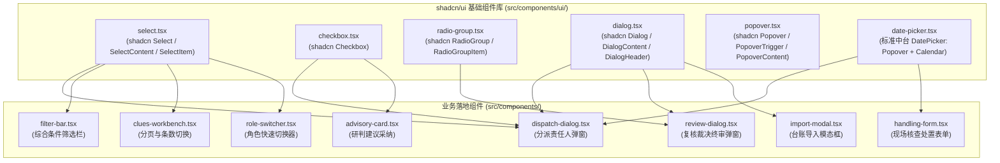

# 表单控件与交互体验体系化重构技术设计说明书 (design.md)

> **设计级别**：标准设计（Standard Design）  
> **前序输入**：`spec/form-controls/requirements.md`  
> **设计基线**：**shadcn/ui 官方组件生态**（基于 `components.json`，Radix UI 原语 + Tailwind CSS v4 + Lucide 矢量图标）  
> **架构修正**：纠正自制原生打补丁思路，全面拥抱项目技术栈 SSOT（shadcn/ui）

---

## 一、架构决策：全面切换为标准 shadcn/ui 组件库

根据项目技术栈定位（`Next.js 15 + Tailwind CSS v4 + shadcn/ui`），此前采用原生标签 + `appearance-none` 伪封装方案存在根本性缺陷：点击展开后仍然是操作系统底层的粗糙原生菜单，各浏览器表现割裂。

本次设计**全面拥抱 shadcn/ui 官方组件生态**：
1. **统一浮层与微交互**：所有下拉菜单、单选复选、模态框采用 Radix UI 无障碍原语（`@radix-ui` / `radix-ui`），拥有真正的现代浮层、弹性动画、滚动视口、按键导航与主题变量同步。
2. **彻底解决日期悬空痛点**：提供符合 shadcn 规范的 DatePicker（结合 `Button` + `Calendar` / `Popover` 或深度样式定制的 DatePickerInput），右侧图标与所有输入框、下拉框严格垂直对齐。
3. **消除纯文本字符**：统一使用 shadcn Dialog 自带的标准 `<X />` 关闭图标与标准弹窗动画。

---

## 二、组件拓扑与文件落位



---

## 三、shadcn/ui 核心原子组件设计与集成

### 3.1 `Select` 组件（基于 shadcn 官方 `select.tsx`）
- **核心文件**：`src/components/ui/select.tsx`
- **组件结构**：
  ```tsx
  <Select value={value} onValueChange={setValue}>
    <SelectTrigger className="w-full h-9 text-xs">
      <SelectValue placeholder="请选择承办部门" />
    </SelectTrigger>
    <SelectContent>
      {options.map((opt) => (
        <SelectItem key={opt.value} value={opt.value} className="text-xs">
          {opt.label}
        </SelectItem>
      ))}
    </SelectContent>
  </Select>
  ```
- **视觉特征**：
  - `SelectTrigger` 具备平滑边框与焦点环，右侧内置 `ChevronDown`。
  - `SelectContent` 为带阴影（`shadow-md`）、圆角（`rounded-lg`）与进出场缩放动效的高级浮层，选中项自带 `Check` 图标，彻底淘汰操作系统丑陋的原生菜单。

### 3.2 `DatePicker` 组件（基于 shadcn 官方 `Popover` + `Calendar`）
- **核心文件**：`src/components/ui/date-picker.tsx`
- **组件结构**：
  ```tsx
  <Popover>
    <PopoverTrigger asChild>
      <Button
        variant="outline"
        className={cn(
          "w-full h-9 justify-between text-left font-normal text-xs",
          !date && "text-muted-foreground"
        )}
      >
        <span>{date ? format(date, "yyyy-MM-dd") : "请选择办理期限"}</span>
        <CalendarIcon className="h-4 w-4 text-slate-400" />
      </Button>
    </PopoverTrigger>
    <PopoverContent className="w-auto p-0" align="start">
      <Calendar mode="single" selected={date} onSelect={setDate} initialFocus />
    </PopoverContent>
  </Popover>
  ```
- **视觉特征**：
  - 触发器外表与 `SelectTrigger`、`Input` 高度（`h-9`）、圆角、边框、字体大小 100% 像素级对齐。
  - 右侧日历图标绝对对齐在最右侧。
  - 点击弹出优雅的日历卡片，直观点击选定年月日，消除浏览器原生小日历悬空和格式提示 `(YYYY-MM-DD)` 的痛点。

### 3.3 `Checkbox` 组件（基于 shadcn 官方 `checkbox.tsx`）
- **核心文件**：`src/components/ui/checkbox.tsx`
- **组件结构**：
  ```tsx
  <div className="flex items-center gap-2">
    <Checkbox id="review" checked={checked} onCheckedChange={setChecked} />
    <label htmlFor="review" className="text-xs text-slate-700 dark:text-slate-300 cursor-pointer">
      办结后需要部门负责人复核
    </label>
  </div>
  ```
- **视觉特征**：
  - 具有平滑圆角、微边框过渡与带有 Check 矢量图标的翠绿色高亮动效，点击文字即可联动切换。

### 3.4 `RadioGroup` 组件（基于 shadcn 官方 `radio-group.tsx`）
- **核心文件**：`src/components/ui/radio-group.tsx`
- **组件结构**：
  ```tsx
  <RadioGroup value={action} onValueChange={setAction} className="flex gap-4">
    <div className="flex items-center gap-1.5 cursor-pointer">
      <RadioGroupItem value="APPROVE" id="r-approve" className="text-emerald-600 border-emerald-600" />
      <Label htmlFor="r-approve" className="text-xs font-semibold text-emerald-700 dark:text-emerald-400 cursor-pointer">
        复核通过 (流转至已完成)
      </Label>
    </div>
    <div className="flex items-center gap-1.5 cursor-pointer">
      <RadioGroupItem value="REJECT" id="r-reject" className="text-red-600 border-red-600" />
      <Label htmlFor="r-reject" className="text-xs font-semibold text-red-700 dark:text-red-400 cursor-pointer">
        驳回退回 (退回办理中)
      </Label>
    </div>
  </RadioGroup>
  ```

### 3.5 `Dialog` 组件（基于 shadcn 官方 `dialog.tsx`）
- **核心文件**：`src/components/ui/dialog.tsx`
- **特征**：
  - 自带平滑淡入淡出动画（`tw-animate-css`）。
  - 右上角自动集成精美的矢量关闭按钮 `<X className="h-4 w-4" />`，悬浮微暗淡动画，彻底消除 `✕` 纯文本字符。

---

## 四、业务组件重构改造方案

1. **分派线索弹窗 (`dispatch-dialog.tsx`)**：
   - 承办部门、承办人员采用 shadcn `Select`。
   - 要求办理期限采用 shadcn `DatePicker`，去除冗余标签文本。
   - 复核选项采用 shadcn `Checkbox`。
   - 弹窗外壳统一采用 shadcn `Dialog`，自动携带矢量 `X` 关闭。
2. **综合筛选工具栏 (`filter-bar.tsx`)**：
   - 区域、类型、风险等级、状态、异常特征 5 个下拉全部换成 shadcn `Select`，选项带优雅高亮与统一阴影浮层。
3. **现场核查处置登记 (`handling-form.tsx`)**：
   - 调查日期采用 shadcn `DatePicker`。
4. **终审复核弹窗 (`review-dialog.tsx`)**：
   - 裁决选项采用 shadcn `RadioGroup`。
   - 弹窗外壳采用 shadcn `Dialog`。
5. **台账导入弹窗 (`import-modal.tsx`)**：
   - 弹窗外壳采用 shadcn `Dialog`，消除文本字符 `✕`。
6. **分页条数与角色切换 (`clues-workbench.tsx`, `role-switcher.tsx`)**：
   - 采用紧凑尺寸（`h-8`）的 shadcn `Select`。
7. **研判建议卡片 (`advisory-card.tsx`)**：
   - 采用 shadcn `Checkbox`。

---

## 五、验证与门禁标准

1. `npm run typecheck`：通过 TypeScript 静态编译，所有组件 Props 严格类型安全。
2. `npm run check:consistency`：工程规范全绿。
3. `npm run test`：所有业务逻辑和全流程自动化验收场景 100% 通过。
