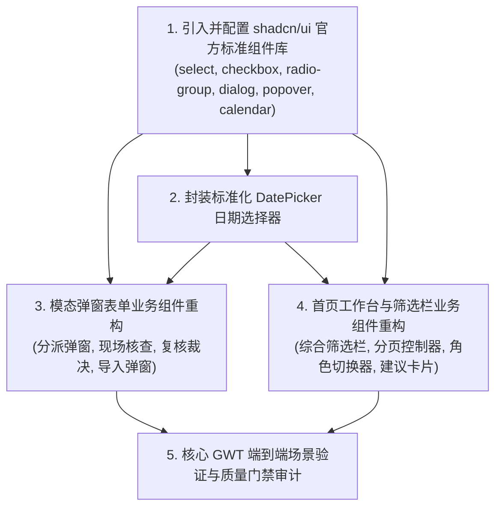

# 表单控件与交互体验体系化重构任务分解清单 (tasks.md)

> **前序输入**：`spec/form-controls/requirements.md`、`spec/form-controls/design.md`（已升级为 shadcn/ui 官方组件体系）  
> **任务状态**：已全部实现并验证通过 (All Completed)  
> **完成时间**：2026-11-10

---

## 任务分组与依赖拓扑

---

## 一、引入并配置 shadcn/ui 官方标准组件库

- [x] **1. 引入并配置 shadcn/ui 官方标准组件库**
  - _Requirements:_ EARS-FC-001, EARS-FC-004, EARS-FC-005, EARS-FC-006
  - _Boundary:_ `src/components/ui/select.tsx`, `src/components/ui/checkbox.tsx`, `src/components/ui/radio-group.tsx`, `src/components/ui/dialog.tsx`, `src/components/ui/popover.tsx`, `src/components/ui/calendar.tsx`
  - [x] 1.1 通过 `shadcn` CLI 初始化并添加官方核心表单组件：`select`、`checkbox`、`radio-group`、`dialog`
  - [x] 1.2 添加官方日期浮层核心原语：`popover` 与 `calendar`（依赖 `react-day-picker` 及 `date-fns`）
  - [x] 1.3 校验新组件在 Tailwind CSS v4 与项目自定义 CSS 变量下的适配情况，确保深浅主题完美渲染

---

## 二、封装标准化 DatePicker 日期选择器

- [x] **2. 封装标准化 DatePicker 日期选择器**
  - _Depends:_ 1
  - _Requirements:_ EARS-FC-002, EARS-FC-003, EARS-FC-005
  - _Boundary:_ `src/components/ui/date-picker.tsx`
  - [x] 2.1 创建 `src/components/ui/date-picker.tsx`，将 `Popover` 与 `Calendar` 组合为即插即用的受控日期选择器
  - [x] 2.2 触发按钮与 `SelectTrigger` 保持像素级对齐（高度 `h-9`、圆角 `rounded-lg`、右侧绝对居中对齐 `CalendarIcon`）
  - [x] 2.3 支持空值占位文案、字符串 `YYYY-MM-DD` 格式双向绑定与禁用态

---

## 三、模态弹窗表单业务组件重构

- [x] **3. 模态弹窗表单业务组件重构**
  - _Depends:_ 1, 2
  - _Requirements:_ EARS-FC-001, EARS-FC-002, EARS-FC-003, EARS-FC-004, EARS-FC-007
  - _Boundary:_ `src/components/clues/dispatch-dialog.tsx`, `src/components/clues/handling-form.tsx`, `src/components/clues/review-dialog.tsx`, `src/components/clues/import-modal.tsx`
  - [x] 3.1 重构分派线索责任人弹窗 `dispatch-dialog.tsx`：
    - 承办责任部门、人员替换为 shadcn `Select`
    - 办理期限替换为 shadcn `DatePicker`，移除 Label 冗余 `(YYYY-MM-DD)`
    - 复核复选框替换为 shadcn `Checkbox`
    - 弹窗采用 shadcn `Dialog`，自动集成矢量 `X` 关闭按钮与背景淡入淡出动画
  - [x] 3.2 重构现场核查与处置表单 `handling-form.tsx`：
    - 调查日期替换为 shadcn `DatePicker`
  - [x] 3.3 重构线索终审复核弹窗 `review-dialog.tsx`：
    - 裁决单选框替换为 shadcn `RadioGroup`（复核通过绿色态、驳回退回红色态）
    - 弹窗外壳统一为 shadcn `Dialog`
  - [x] 3.4 重构台账导入模态框 `import-modal.tsx`：
    - 弹窗外壳统一为 shadcn `Dialog`，彻底清除文本字符 `✕`

---

## 四、首页工作台与筛选栏业务组件重构

- [x] **4. 首页工作台与筛选栏业务组件重构**
  - _Depends:_ 1
  - _Requirements:_ EARS-FC-001, EARS-FC-005, EARS-FC-007, EARS-FC-008
  - _Boundary:_ `src/components/clues/filter-bar.tsx`, `src/components/clues/clues-workbench.tsx`, `src/components/role-switcher.tsx`, `src/components/clues/advisory-card.tsx`
  - [x] 4.1 重构综合筛选栏 `filter-bar.tsx`：所属区域、类型、风险等级、状态、异常特征 5 个筛选下拉全部替换为 shadcn `Select`，彻底消除粗糙操作系统原生菜单
  - [x] 4.2 重构工作台分页控制栏 `clues-workbench.tsx`：每页条数选择器替换为 shadcn `Select`（紧凑尺寸 `h-8`）
  - [x] 4.3 重构顶部角色快速切换器 `role-switcher.tsx`：切换下拉框替换为 shadcn `Select`（紧凑尺寸 `h-8`）
  - [x] 4.4 重构处置建议卡片 `advisory-card.tsx`：建议已采纳复选框替换为 shadcn `Checkbox`

---

## 五、核心 GWT 端到端场景验证与质量门禁审计

- [x] **5. 核心 GWT 端到端场景验证与质量门禁审计**
  - _Depends:_ 3, 4
  - _Requirements:_ EARS-FC-001 ~ EARS-FC-008
  - _Boundary:_ `src/tests/*`, `package.json`
  - [x] 5.1 **核心 GWT 端到端验收场景 1：分派弹窗现代浮层与日期选择验证**
    - **Given**：综合管理人员点击分派线索（如 `CLUE-2026-001`）
    - **When**：观察分派弹窗中的承办部门、承办人员下拉框与要求办理期限
    - **Then**：点击下拉框弹出精致的 shadcn 阴影浮层（包含 Checkmark 选中标记与平滑动效），无任何操作系统原生菜单；点击要求办理期限弹出日历卡片，选定日期后自动填入；右侧向下箭头与日历图标严格垂直对齐；右上角为平滑矢量 `X` 关闭按钮
  - [x] 5.2 **核心 GWT 端到端验收场景 2：工作台多维筛选与分页联动验证**
    - **Given**：线索工作台大盘呈现中
    - **When**：用户通过 shadcn `Select` 连续切换「所属区域」、「风险等级」、「异常预警特征」以及分页条数
    - **Then**：下拉面板展现正统现代中台质感，深浅主题无白斑，列表过滤响应与分页联动完全正确
  - [x] 5.3 **核心 GWT 端到端验收场景 3：终审复核裁决与快捷单选验证**
    - **Given**：部门负责人打开待复核线索终审弹窗
    - **When**：点击切换「复核通过」与「驳回退回」shadcn `RadioGroup`
    - **Then**：单选具备优雅的绿色与红色区分标记，点击文字标签灵敏触发；点击关闭按钮或遮罩层平滑关闭
  - [x] 5.4 执行确定性代码质量门禁：
    - `npm run typecheck`（TypeScript 静态类型检查零错误，全部通过）
    - `npm run check:consistency`（工程命名与一致性校验全绿，全部通过）
    - `npm run test`（全量自动化单元与集成测试 58/58 通过，全部通过）
